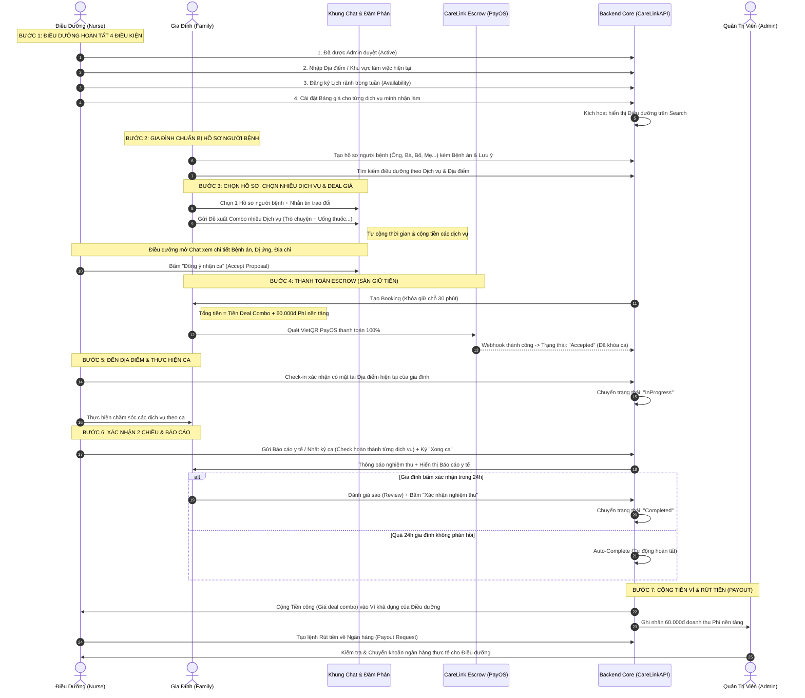

# 📋 BÁO CÁO HOÀN THIỆN LUỒNG BOOKING & ĐÀM PHÁN GIÁ CARELINK (V2.1)
### *Đã cập nhật: Hỗ trợ 1 Ca chọn Nhiều Dịch vụ (Multi-Services Combo), Đơn giản hóa GPS thành Địa điểm hiện tại, 4 Điều kiện Điều dưỡng, Quản lý nhiều hồ sơ Người bệnh & Xem bệnh án trong Chat*

> **Người thực hiện:** Antigravity AI Assistant  
> **Ngày cập nhật:** 23/10/2026 (Phiên bản 2.1 - Bổ sung tính năng Combo Đa Dịch vụ)  
> **Trạng thái:** `Chờ người dùng chốt duyệt (Pending Final Approval)` — **Chưa sửa code khi chưa có xác nhận.**

---

## 1. TÓM TẮT TOÀN DIỆN LUỒNG NGHIỆP VỤ (V2.1)

Quy trình booking và chăm sóc y tế hoàn chỉnh gồm 8 mắt xích chính:

1. **Gia đình quản lý Hồ sơ người bệnh (`CareRecipient`):**
   - Gia đình có thể tạo **nhiều hồ sơ người bệnh** (ví dụ: Hồ sơ Bố, Hồ sơ Mẹ, Ông, Bà...).
   - **Bắt buộc:** Trước khi tìm điều dưỡng, đặt lịch hoặc nhắn tin deal giá, gia đình **phải chọn 1 hồ sơ người bệnh cụ thể**. Nếu chưa có hồ sơ nào, hệ thống yêu cầu tạo mới trước.
2. **Điều kiện tiên quyết để Điều dưỡng nhận được ca (Bắt buộc đủ 4 yếu tố):**
   - Điều dưỡng chỉ hiển thị trên kết quả tìm kiếm và gia đình chỉ book được khi điều dưỡng đã hoàn tất:
     + (1) Hồ sơ đã được Admin duyệt (`Active`) và xác thực email/bằng cấp.
     + (2) Đã thiết lập **Lịch rảnh** (`NurseAvailability` - ít nhất 1 khung giờ trong tuần).
     + (3) Đã cài đặt **Bảng giá cho từng dịch vụ** mình nhận làm (`NurseServicePricing`).
     + (4) Đã cập nhật **Địa điểm / Khu vực làm việc hiện tại** (nhập địa chỉ/quận huyện hành chính).
3. **Một ca trực có thể chọn NHIỀU DỊCH VỤ (Multi-Services Combo):**
   - Trong 1 ca chăm sóc, gia đình có thể tick chọn **nhiều dịch vụ cùng lúc** từ điều dưỡng.
   - *Ví dụ thực tế:* 
     + Dịch vụ 1: **Trò chuyện tâm sự, đọc sách** (100.000 VNĐ, 60 phút)
     + Dịch vụ 2: **Hỗ trợ cho uống thuốc & đo huyết áp** (80.000 VNĐ, 30 phút)
   - **Tự động tính toán:**
     + $\text{Tổng thời gian ca trực} = 60\text{p} + 30\text{p} = \mathbf{90\ \text{phút}}$.
     + $\text{Tổng giá dịch vụ niêm yết} = 100.000 + 80.000 = \mathbf{180.000\ VNĐ}$.
4. **Đơn giản hóa GPS thành "Địa điểm hiện tại" (Không chặn tọa độ khắt khe):**
   - Cả 2 bên chỉ cần điền **Địa điểm / Địa chỉ hiện tại** (text dạng địa chỉ, ví dụ: *"Số 123 đường 3/2, Q. Ninh Kiều, Cần Thơ"*).
   - Khi điều dưỡng đến nhà làm việc, bấm Check-in xác nhận có mặt tại địa điểm. Hệ thống **không bắt buộc so khớp tọa độ GPS bán kính 500m cứng nhắc**, giúp tránh lỗi khi chạy thử nghiệm hoặc thiết bị mất sóng GPS.
5. **Deal giá trực tiếp trong Khung Chat & Điều dưỡng xem Hồ sơ bệnh án:**
   - Gia đình gửi Đề xuất ca (`BookingProposal`) qua Chat kèm **danh sách các dịch vụ đã chọn** và giá mong muốn (có thể giữ nguyên 180k hoặc đàm phán tăng/giảm theo thỏa thuận).
   - **Điều dưỡng mở Chat bấm xem chi tiết toàn bộ hồ sơ người bệnh** (Tuổi, Giới tính, Tiền sử bệnh án, Dị ứng, Lưu ý đặc biệt, Địa điểm chăm sóc) ngay trong khung chat để cân nhắc trước khi bấm *"Đồng ý nhận ca"*.
6. **Thanh toán Escrow 2 phần minh bạch (Sàn tạm giữ tiền):**
   - Sau khi 2 bên chốt đề xuất, gia đình thanh toán:
     $$\text{Tổng thanh toán} = \text{Tiền công điều dưỡng (Tổng giá deal các dịch vụ)} + \mathbf{60.000\ VNĐ}\ \text{(Phí nền tảng cố định)}$$
   - CareLink tạm giữ 100% số tiền (Escrow qua PayOS VietQR). Điều dưỡng yên tâm di chuyển vì khách đã cọc tiền; khách yên tâm vì sàn chưa giải ngân tiền cho điều dưỡng.
7. **Thực hiện ca & Nghiệm thu 2 chiều (Dual Confirmation & Report):**
   - Điều dưỡng thực hiện chăm sóc, kết thúc ca gửi **Báo cáo y tế / Nhật ký chăm sóc** (tích hoàn thành các dịch vụ trong ca) và bấm *"Xác nhận hoàn thành phía Điều dưỡng"*.
   - Gia đình kiểm tra, đánh giá sao (Review) và bấm *"Xác nhận nghiệm thu phía Gia đình"*.
   - **Khi cả 2 bên cùng xác nhận**, đơn mới chính thức chuyển sang trạng thái `Completed`.
   - *(Cơ chế bảo vệ: Nếu gia đình quên bấm, sau 24 giờ không có khiếu nại, hệ thống tự động Auto-Complete để giải phóng tiền cho điều dưỡng).*
8. **Quyết toán & Chi trả tiền công (Payout):**
   - Tiền công (giá deal các dịch vụ) chuyển thẳng vào ví khả dụng của Điều dưỡng.
   - Điều dưỡng tạo lệnh Rút tiền (`Payout Request`), Admin kiểm tra và duyệt chuyển khoản ngân hàng thực tế cho điều dưỡng.

---

## 2. BẢNG SO SÁNH HIỆN TRẠNG VS ĐỀ XUẤT V2.1

| Mắt xích nghiệp vụ | Hiện trạng trong Backend (`CareLink_BE`) | Đề xuất mới của bạn (V2.1) | Giải pháp kỹ thuật tương ứng |
| :--- | :--- | :--- | :--- |
| **1. Số lượng dịch vụ trong 1 ca** | **Chỉ nhận 1 dịch vụ duy nhất** (`Booking.ServiceId`, `BookingProposal.ServiceId`). | **1 Ca nhận NHIỀU dịch vụ cùng lúc:** Tự động cộng dồn thời gian và cộng tiền các dịch vụ (ví dụ: Trò chuyện + Cho uống thuốc). | Thêm bảng phụ `booking_services` và `booking_proposal_services`. Vẫn giữ `ServiceId` là dịch vụ chính để đảm bảo tương thích ngược 100%. |
| **2. Quản lý Hồ sơ người bệnh** | Đã có CRUD `CareRecipient` (`RecipientsController`), nhưng chưa ép buộc phải chọn trước khi vào luồng chat/deal. | Gia đình tạo được nhiều hồ sơ; Bắt buộc phải chọn 1 hồ sơ trước khi book; Chưa có thì bắt tạo. | Ràng buộc `RecipientId` bắt buộc trong `CreateProposalRequest` và `CreateBookingRequest`. Bổ sung API kiểm tra nhanh gia đình đã có hồ sơ chưa. |
| **3. Điều kiện hiển thị Điều dưỡng** | Chỉ kiểm tra `Status == Active`. Điều dưỡng chưa có lịch rảnh, chưa có giá riêng vẫn hiện ra. | Bắt buộc đủ 4 điều kiện: (1) Active, (2) Có lịch rảnh, (3) Có bảng giá dịch vụ, (4) Có địa điểm làm việc. | Cập nhật bộ lọc trong `NurseSearchService.cs`: loại bỏ ngay các điều dưỡng chưa hoàn tất 4 điều kiện trên. |
| **4. Cài đặt bảng giá dịch vụ** | Giá dịch vụ cố định theo bảng `services` chung toàn sàn. | Điều dưỡng tự thiết lập giá mong muốn cho từng dịch vụ mình nhận làm. | Tạo bảng mới `nurse_service_pricings` và bộ API cấu hình giá dịch vụ cho Điều dưỡng. |
| **5. Địa điểm & GPS** | Check-in bắt buộc toạ độ GPS Haversine $\le$ 500m (`BookingService.StartAsync`). | Bỏ chặn GPS cứng; cả 2 bên chỉ cần điền text "Địa điểm / Địa chỉ hiện tại". Check-in ghi nhận địa điểm thực tế. | Nới lỏng kiểm tra GPS trong `BookingService`: chỉ lưu tọa độ nếu có (optional), chuyển sang ghi nhận trạng thái đã đến địa điểm chăm sóc. |
| **6. Xem hồ sơ bệnh án trong Chat** | DTO `BookingProposalResponse` chỉ có `RecipientId` và `RecipientName`. | Điều dưỡng bấm xem được toàn bộ chi tiết hồ sơ bệnh án (tuổi, tiền sử bệnh, dị ứng, lưu ý đặc biệt) ngay trong Chat. | Mở rộng `BookingProposalResponse` thêm: `DateOfBirth`, `Gender`, `MedicalHistory`, `SpecialNotes`, `Address`. Mở quyền cho Điều dưỡng xem chi tiết hồ sơ bệnh nhân đang chat. |
| **7. Deal giá & Thanh toán Escrow** | Đã có `BookingProposal` (State Machine ADR-003) và `PlatformFee = 60.000đ` (PayOS). | Giữ nguyên: Giá deal + 60k phí sàn. Sàn thu hết và tạm giữ tiền (Escrow). | Hiển thị bóc tách minh bạch 2 dòng trên màn hình Checkout: `Tiền dịch vụ` và `Phí nền tảng (60.000đ)`. |
| **8. Nghiệm thu 2 chiều** | Chỉ có Điều dưỡng bấm `FinishAsync` là ca tự hoàn thành và cộng ví ngay. | Cả Điều dưỡng (nộp báo cáo) và Gia đình (nộp review) cùng bấm xác nhận thì mới `Completed`. Có Auto-complete 24h. | Thêm 2 trường `nurse_confirmed_at`, `customer_confirmed_at` vào bảng `bookings`. Tách API xác nhận 2 bên và Background Worker Auto-Complete 24h. |

---

## 3. SƠ ĐỒ TUẦN TỰ HOÀN CHỈNH (END-TO-END WORKFLOW)



---

## 4. DANH MỤC THAY ĐỔI KỸ THUẬT CHI TIẾT

### 🗄️ 1. Cơ sở dữ liệu (Supabase PostgreSQL):

```sql
-- 1. Bảng giá dịch vụ của từng điều dưỡng
CREATE TABLE IF NOT EXISTS public.nurse_service_pricings (
    id UUID PRIMARY KEY DEFAULT gen_random_uuid(),
    nurse_id UUID NOT NULL REFERENCES public.nurses(id) ON DELETE CASCADE,
    service_id UUID NOT NULL REFERENCES public.services(id) ON DELETE CASCADE,
    custom_price NUMERIC(12,2) NOT NULL CHECK (custom_price >= 0),
    is_offered BOOLEAN NOT NULL DEFAULT true,
    created_at TIMESTAMPTZ NOT NULL DEFAULT timezone('utc'::text, now()),
    updated_at TIMESTAMPTZ NOT NULL DEFAULT timezone('utc'::text, now()),
    CONSTRAINT uq_nurse_service UNIQUE (nurse_id, service_id)
);

-- 2. Bảng lưu danh sách các dịch vụ trong 1 Đề xuất ca (Proposal)
CREATE TABLE IF NOT EXISTS public.booking_proposal_services (
    id UUID PRIMARY KEY DEFAULT gen_random_uuid(),
    proposal_id UUID NOT NULL REFERENCES public.booking_proposals(id) ON DELETE CASCADE,
    service_id UUID NOT NULL REFERENCES public.services(id) ON DELETE RESTRICT,
    price NUMERIC(12,2) NOT NULL DEFAULT 0,
    duration_minutes INT NOT NULL DEFAULT 0,
    created_at TIMESTAMPTZ NOT NULL DEFAULT timezone('utc'::text, now())
);

-- 3. Bảng lưu danh sách các dịch vụ trong 1 Ca trực chính thức (Booking)
CREATE TABLE IF NOT EXISTS public.booking_services (
    id UUID PRIMARY KEY DEFAULT gen_random_uuid(),
    booking_id UUID NOT NULL REFERENCES public.bookings(id) ON DELETE CASCADE,
    service_id UUID NOT NULL REFERENCES public.services(id) ON DELETE RESTRICT,
    price NUMERIC(12,2) NOT NULL DEFAULT 0,
    duration_minutes INT NOT NULL DEFAULT 0,
    created_at TIMESTAMPTZ NOT NULL DEFAULT timezone('utc'::text, now())
);

-- 4. Mở rộng bảng bookings cho xác nhận 2 chiều
ALTER TABLE public.bookings 
    ADD COLUMN IF NOT EXISTS nurse_confirmed_at TIMESTAMPTZ NULL,
    ADD COLUMN IF NOT EXISTS customer_confirmed_at TIMESTAMPTZ NULL;
```

### ⚙️ 2. Backend APIs (`CareLinkAPI`):

1. **Hỗ trợ Nhiều Dịch vụ trong Đề xuất ca (`CreateProposalRequest`):**
   - Hỗ trợ truyền danh sách: `public List<Guid> ServiceIds { get; set; } = new();`
   - Tính toán tự động tổng `ScheduledEnd = ScheduledStart + TotalDurationMinutes`.
   - Tính toán gợi ý `TotalPrice = Sum(NurseCustomPrice hoặc BasePrice)`.
   - `BookingProposalResponse` trả về danh sách chi tiết: `public List<ProposalServiceItemDto> Services { get; set; }`.
2. **Quản lý Giá dịch vụ của Điều dưỡng:**
   - `GET /api/v1/nurse/services/pricing`: Lấy danh sách dịch vụ kèm giá riêng điều dưỡng đã cấu hình.
   - `PUT /api/v1/nurse/services/pricing`: Điều dưỡng cập nhật giá mong muốn cho từng dịch vụ.
3. **Kiểm tra điều kiện nhận ca của Điều dưỡng:**
   - Cập nhật `NurseSearchService`: Chỉ hiển thị điều dưỡng khi có đủ (Active + Lịch rảnh + Bảng giá + Địa bàn làm việc).
   - `GET /api/v1/nurses/readiness-status`: API cho chính điều dưỡng kiểm tra mình đã đủ 4 điều kiện để nhận ca hay chưa.
4. **Mở rộng Thông tin Người bệnh trong Khung Chat:**
   - Mở rộng DTO `BookingProposalResponse`: Trả về `RecipientDateOfBirth`, `RecipientAge`, `RecipientGender`, `RecipientMedicalHistory`, `RecipientSpecialNotes`, `RecipientAddress`.
   - `GET /api/v1/recipients/{id}`: Cho phép Điều dưỡng có trong hội thoại chat với gia đình xem được chi tiết hồ sơ bệnh nhân này.
5. **Đơn giản hóa Check-in Địa điểm:**
   - Cập nhật `BookingService.StartAsync`: Chấp nhận Check-in dựa trên địa chỉ/địa điểm, không ném lỗi `400 BadRequest` vì khoảng cách GPS.
6. **Nghiệm thu 2 chiều & Tự động hoàn thành:**
   - `POST /api/v1/bookings/{id}/nurse-confirm`: Điều dưỡng nộp Báo cáo y tế và ký hoàn tất.
   - `POST /api/v1/bookings/{id}/customer-confirm`: Gia đình đánh giá review và ký nghiệm thu $\rightarrow$ Chuyển `Completed` và cộng ví điều dưỡng.
   - Background Hosted Service (`BookingAutoCompleteWorker`): Quét các đơn sau 24h kể từ khi điều dưỡng ký mà gia đình không khiếu nại thì tự động hoàn tất.

---

## 5. RÀ SOÁT CHÉO FRONTEND & SUPABASE (THEO QUY TẮC AGENTS.MD)

### 📌 Frontend (`CareLink_FE`) cần cập nhật những màn hình & trường nào:
1. **Màn hình Tạo Đề xuất ca / Đặt lịch (Gia đình):**
   - Cho phép tick chọn **nhiều dịch vụ** (Checkboxes danh sách dịch vụ của điều dưỡng).
   - Hiển thị bảng tính realtime:
     + Danh sách dịch vụ được tick: Dịch vụ A (80k) + Dịch vụ B (100k) = **180k**.
     + Phí nền tảng CareLink: **60.000đ**.
     + Tổng dự kiến: **240.000đ** (Có ô input cho phép gia đình chỉnh sửa giá deal nếu muốn thương lượng).
2. **Màn hình Hồ sơ người bệnh (Khách hàng):**
   - Đảm bảo có giao diện quản lý danh sách nhiều hồ sơ người bệnh (`CareRecipient`).
   - Bắt buộc Dropdown: **"Chọn hồ sơ người bệnh cần chăm sóc"** trước khi mở modal tạo đề xuất.
3. **Màn hình Cài đặt của Điều dưỡng:**
   - Màn hình **"Cài đặt Bảng giá dịch vụ"**: Điều dưỡng tích chọn các dịch vụ mình có thể làm và điền đơn giá cho từng dịch vụ.
   - Checklist **"Trạng thái sẵn sàng nhận ca"** (4 điều kiện).
4. **Màn hình Khung Chat (`ConversationDetail`):**
   - Thẻ Đề xuất ca hiển thị:
     + Danh sách các dịch vụ kèm theo (ví dụ: *1. Trò chuyện (60p) - 2. Cho uống thuốc (30p)*).
     + Nút **"Xem hồ sơ người bệnh"** để điều dưỡng mở modal xem bệnh án chi tiết.
5. **Màn hình Chi tiết Ca trực (`BookingDetail`):**
   - Hiển thị danh sách các dịch vụ cần làm trong ca trực này để điều dưỡng tiện theo dõi và tích hoàn thành trong Báo cáo y tế.

---

## 6. XÁC NHẬN TRIỂN KHAI

Toàn bộ tài liệu chi tiết phiên bản V2.1 đã được cập nhật hoàn chỉnh tại [`docs/BOOKING_FLOW_REVIEW_AND_PROPOSAL.md`](file:///d:/Documents/EXE1/CareLink_BE/docs/BOOKING_FLOW_REVIEW_AND_PROPOSAL.md).

👉 **Bạn thấy thiết kế tính năng Combo Nhiều Dịch Vụ và toàn bộ luồng V2.1 này đã đúng 100% mong muốn chưa? Nếu bạn đồng ý, hãy phản hồi "OK" hoặc "Đồng ý", tôi sẽ tiến hành triển khai code Backend và chạy migration DB ngay!**
