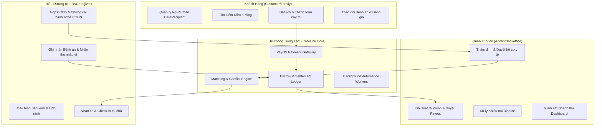
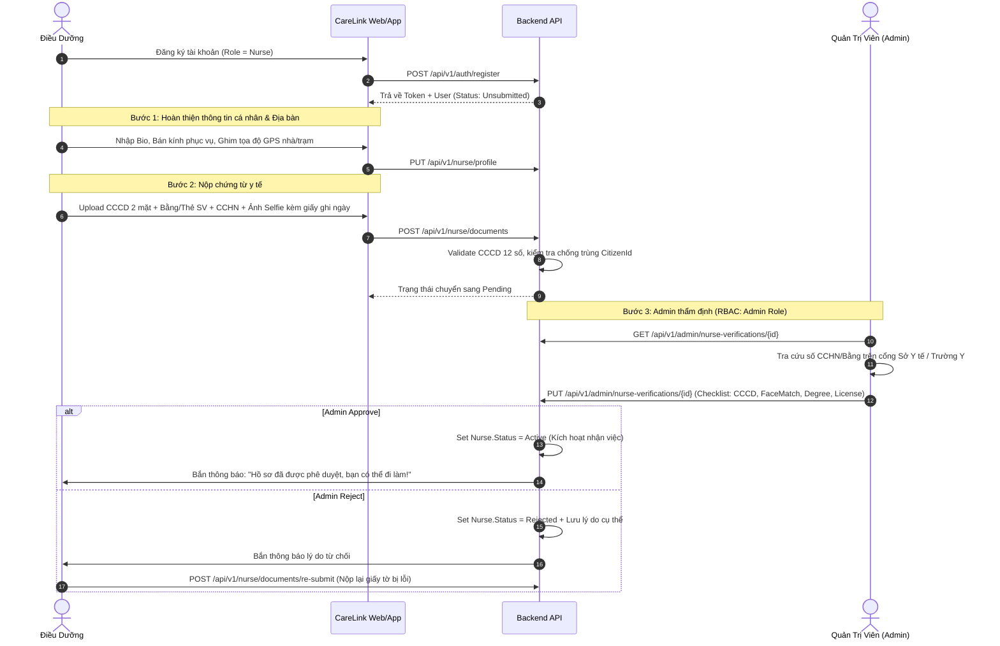
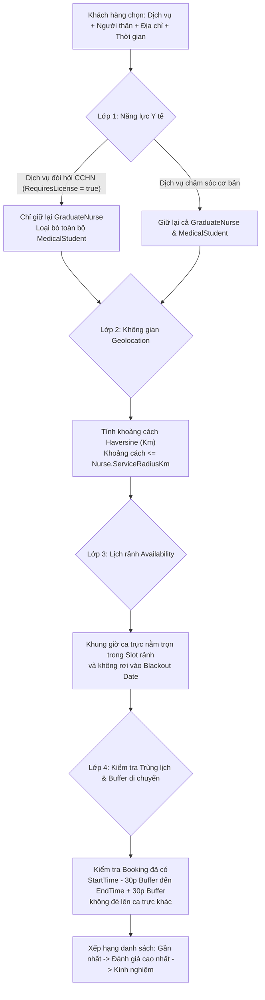
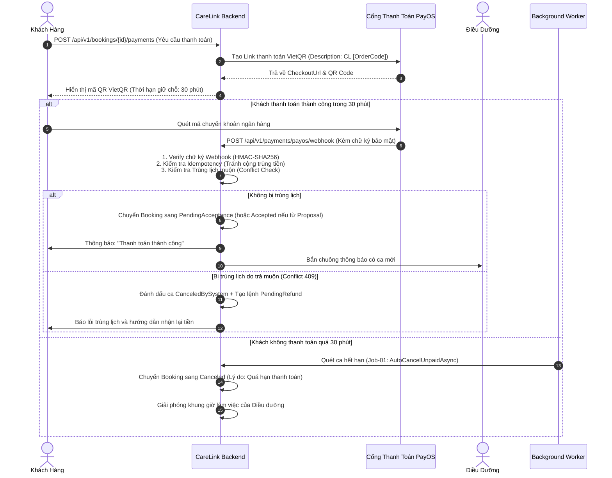
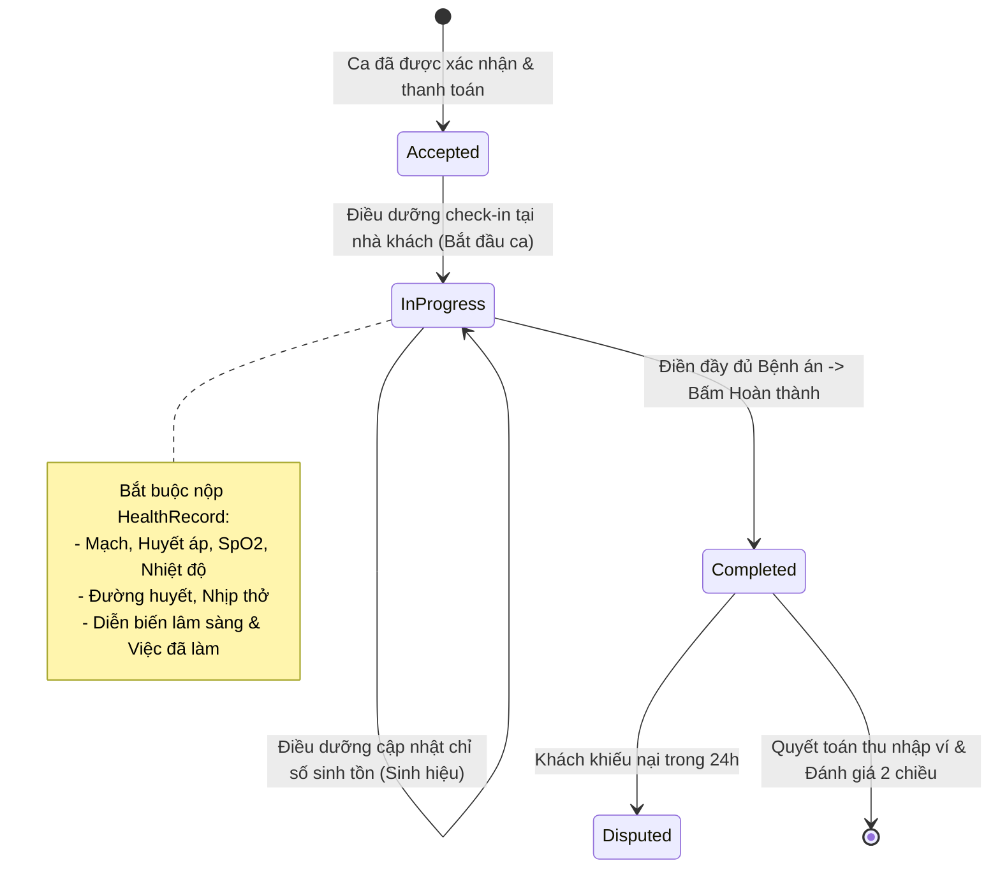

# 📘 CARELINK MASTER BUSINESS WORKFLOW & SYSTEM SPECIFICATION
### *Tài liệu Tổng quát Kiến trúc Nghiệp vụ, Luồng Vận hành và Chuẩn hóa Hệ thống*

> **Phiên bản:** 2.0 (Master Release)  
> **Áp dụng cho:** `CareLink_BE` (ASP.NET Core / EF Core / PostgreSQL Supabase) & `CareLink_FE` (React / Vite)  
> **Mục tiêu:** Định hình toàn diện 100% các luồng nghiệp vụ, giải quyết triệt để các lỗ hổng logic, bảo mật, tài chính và y tế, đảm bảo hệ thống vận hành trơn tru, liền mạch và an toàn thực tế.

---

## 🧭 MỤC LỤC TỔNG QUAN

1. [Tổng Quan Hệ Thống & 4 Nhóm Chủ Thể (System Actors)](#1-tổng-quan-hệ-thống--4-nhóm-chủ-thể)
2. [Luồng 1: Xác Thực Danh Tính & Onboarding Điều Dưỡng (Nurse Verification Flow)](#luồng-1-xác-thực-danh-tính--onboarding-điều-dưỡng)
3. [Luồng 2: Cấu Hình Địa Bàn & Thiết Lập Lịch Làm Việc (Schedule & Availability Flow)](#luồng-2-cấu-hình-địa-bàn--thiết-lập-lịch-làm-việc)
4. [Luồng 3: Tìm Kiếm, Khớp Lịch & Đặt Ca Chăm Sóc (Search & Matching Engine)](#luồng-3-tìm-kiếm-khớp-lịch--đặt-ca-chăm-sóc)
5. [Luồng 4: Thanh Toán PayOS, Giữ Chỗ & Xử Lý Xung Đột (Payment & Escrow Flow)](#luồng-4-thanh-toán-payos-giữ-chỗ--xử-lý-xung-đột)
6. [Luồng 5: Thực Hiện Ca Trực, Check-in & Bệnh Án Lâm Sàng (Care Delivery & Health Record)](#luồng-5-thực-hiện-ca-trực-check-in--bệnh-án-lâm-sàng)
7. [Luồng 6: Quyết Toán Ví, Rút Tiền & Chính Sách Hủy Ca Đền Bù (Wallet & Cancellation Fairness)](#luồng-6-quyết-toán-ví-rút-tiền--chính-sách-hủy-ca-đền-bù)
8. [Luồng 7: Xử Lý Khiếu Nại & Đánh Giá 2 Chiều (Disputes & Two-Way Reviews)](#luồng-7-xử-lý-khiếu-nại--đánh-giá-2-chiều)
9. [Bảng Ma Trận Phân Quyền & Bảo Mật Toàn Diện (Security RBAC Matrix)](#bảng-ma-trận-phân-quyền--bảo-mật-toàn-diện)
10. [Checklist Tác Động Cơ Sở Dữ Liệu & Đồng Bộ Frontend (Action Items)](#checklist-tác-động-cơ-sở-dữ-liệu--đồng-bộ-frontend)

---

## 1. TỔNG QUAN HỆ THỐNG & 4 NHÓM CHỦ THỂ

CareLink là nền tảng y tế công nghệ kết nối các gia đình có nhu cầu chăm sóc người thân tại nhà với mạng lưới Điều dưỡng viên chuyên nghiệp và Sinh viên Y khoa.



### 4 Nhóm chủ thể trong hệ thống:
1. **Khách hàng (Customer / Family):** Người trả tiền dịch vụ, tạo danh bạ người cần chăm sóc (`CareRecipient`), tạo ca chăm sóc (`Booking`), theo dõi sức khỏe và để lại đánh giá.
2. **Người nhận chăm sóc (Care Recipient):** Bệnh nhân, người cao tuổi, trẻ nhỏ. Lưu giữ hồ sơ tiền sử bệnh lý và bệnh án lâm sàng sau từng ca trực.
3. **Điều dưỡng (Nurse / Practitioner):**
   * *Điều dưỡng đã tốt nghiệp (`GraduateNurse`):* Bắt buộc có Chứng chỉ hành nghề (CCHN), được phép nhận toàn bộ các dịch vụ (bao gồm thủ thuật xâm lấn: tiêm truyền, đặt sonde dạ dày, sonde tiểu, thay băng cắt chỉ vết mổ...).
   * *Sinh viên Y khoa (`MedicalStudent`):* Chỉ cần Thẻ sinh viên Y còn hạn, **chỉ được nhận các ca chăm sóc sinh hoạt cơ bản** (tắm gội tại giường, hỗ trợ ăn uống, vận động phục hồi chức năng, theo dõi chỉ số sinh tồn cơ bản). Tuyệt đối cấm nhận thủ thuật xâm lấn.
4. **Quản trị viên (Admin):** Thẩm định hồ sơ bằng cấp, giải quyết tranh chấp khiếu nại, duyệt lệnh rút tiền và theo dõi các chỉ số tài chính sàn.

---

## LUỒNG 1: XÁC THỰC DANH TÍNH & ONBOARDING ĐIỀU DƯỠNG

> **Mục tiêu:** Chống mạo danh y tế, ngăn chặn triệt để rủi ro tai biến lâm sàng, bảo vệ tính mạng người bệnh.



### Quy tắc bất biến (Business Invariants):
* **Kiểm tra CCCD:** Đúng định dạng 12 chữ số. Unique constraint toàn bảng – 1 CCCD không thể đăng ký 2 tài khoản.
* **Chống giả mạo ảnh (Selfie Liveness):** Bắt buộc ảnh selfie cầm CCCD kèm một tờ giấy viết tay dòng chữ: `CareLink - [Ngày hiện tại]`.
* **Phân quyền duyệt hồ sơ (Security Gate):** Endpoint `PUT /api/v1/admin/nurse-verifications/{id}` **bắt buộc bọc `[Authorize(Roles = "Admin")]`** và kiểm tra `AdminUserId` có quyền Admin. Nghiêm cấm để hổng cho user tự duyệt.

---

## LUỒNG 2: CẤU HÌNH ĐỊA BÀN & THIẾT LẬP LỊCH LÀM VIỆC

> **Mục tiêu:** Điều dưỡng chủ động sắp xếp thời gian biểu cá nhân, hệ thống đảm bảo đủ dữ liệu không gian và thời gian để ghép ca.

### 1. Hai tầng quản lý lịch rảnh:
1. **Lịch rảnh định kỳ (Weekly Recurring Schedule):**
   * Lưu trong `nurse_availabilities` (`DayOfWeek`: 0 - 6, `StartTime`, `EndTime`, `IsActive`).
   * Mỗi khung giờ rảnh tối thiểu phải đạt **tối thiểu 60 phút** (đảm bảo đủ cho 1 ca chăm sóc).
   * Không được có 2 khung giờ giao nhau hoặc trùng lặp trong cùng 1 thứ.
2. **Ngoại lệ / Nghỉ đột xuất (Blackout Dates / Time-off):**
   * Khi điều dưỡng ốm, bận việc cá nhân vào 1 ngày cụ thể (ví dụ: Thứ Tư tuần sau ngày 25/10), họ đăng ký nghỉ ngày đó mà **không bị mất toàn bộ lịch Thứ Tư của các tuần sau**.

### 2. Điều kiện đủ để Điều dưỡng xuất hiện trên cổng Tìm Kiếm:
Một điều dưỡng chỉ được hiển thị cho khách hàng đặt ca khi thỏa mãn đồng thời **4 điều kiện**:
1. `Nurse.Status == Active` (Đã được Admin duyệt hồ sơ).
2. Đã có tọa độ tâm và bán kính hoạt động (`Latitude != null`, `Longitude != null`, `ServiceRadiusKm > 0`).
3. Có cấu hình khung giờ rảnh bao trùm thời gian khách yêu cầu.
4. Nút trạng thái tổng: `IsAcceptingBookings == true` (Sẵn sàng nhận ca).

---

## LUỒNG 3: TÌM KIẾM, KHỚP LỊCH & ĐẶT CA CHĂM SÓC

> **Mục tiêu:** Ghép đúng người - đúng việc - đúng năng lực chuyên môn, bảo vệ an toàn tối đa cho người bệnh.

### Bộ Lọc Khớp Lịch Đa Tầng (Multi-Layer Matching Engine):



### 2 Phương thức Đặt ca thực tế:

| Tiêu chí so sánh | Hình thức A: Đặt ca trực tiếp (Direct Booking) | Hình thức B: Đề xuất đàm phán trong Chat (Proposal) |
|---|---|---|
| **Kịch bản sử dụng** | Khách chọn dịch vụ chuẩn mẫu, cần đặt nhanh theo khung giờ cố định. | Khách cần trao đổi kỹ tiền sử bệnh, yêu cầu chăm sóc đặc biệt, đàm phán phụ thu. |
| **API Khởi tạo** | `POST /api/v1/bookings` | `POST /api/v1/conversations/{id}/proposals` |
| **Thương lượng giá** | Giá chuẩn cố định từ bảng `Services.BasePrice`. | Cho phép thỏa thuận phụ phí (phụ thu đêm, hỗ trợ xăng xe đi xa). |
| **Thứ tự Đồng ý & Trả tiền** | Tạo ca $\rightarrow$ **Thanh toán trước** $\rightarrow$ Điều dưỡng bấm Nhận ca. | Thỏa thuận chat $\rightarrow$ **Điều dưỡng bấm Nhận trước** $\rightarrow$ Khách thanh toán sau. |
| **Chuyển trạng thái khi Thanh toán** | `PendingPayment` $\rightarrow$ `PendingAcceptance`. | `PendingPayment` $\rightarrow$ `Accepted` trực tiếp. |

---

## LUỒNG 4: THANH TOÁN PAYOS, GIỮ CHỖ & XỬ LÝ XUNG ĐỘT



### Nguyên tắc xử lý tài chính & Cổng PayOS:
1. **Chống xử lý trùng lặp (Idempotency Invariant):** Webhook PayOS gọi nhiều lần với cùng 1 `orderCode` chỉ được cập nhật trạng thái 1 lần duy nhất, tuyệt đối không tạo giao dịch kép.
2. **Cơ chế Escrow (Tạm giữ tiền sàn):** Tiền thanh toán của khách hàng nằm trong tài khoản trung gian của CareLink, **chưa được cộng vào ví điều dưỡng** cho đến khi ca hoàn thành viên mãn kèm bệnh án lâm sàng.
3. **Cấm Sandbox Backdoor:** Tuyệt đối không sinh URL ảo tự đánh dấu `PAID` khi xảy ra lỗi kết nối cổng thanh toán. Khi lỗi cổng, phải trả mã lỗi rõ ràng để khách thử lại.

---

## LUỒNG 5: THỰC HIỆN CA TRỰC, CHECK-IN & BỆNH ÁN LÂM SÀNG

> **Mục tiêu:** Quản lý quy trình chăm sóc minh bạch, lưu vết bệnh án chính xác, bảo vệ quyền lợi người bệnh.



### Các quy tắc thực thi ca trực:
1. **Quy định Check-in (`Accepted` $\rightarrow$ `InProgress`):**
   * Chỉ cho phép bấm Check-in trước giờ hẹn tối đa **15 phút** (`CheckInEarlyMinutes = 15`).
   * *Nâng cao:* FE gửi kèm toạ độ GPS lúc bấm Check-in để đối chiếu với địa chỉ nhà khách hàng (sai số cho phép $< 200m$).
2. **Điều kiện tiên quyết để Hoàn thành ca (`Finish`):**
   * Hàm [`FinishAsync`](file:///d:/Documents/EXE1/CareLink_BE/CareLinkAPI/Services/BookingService.cs#L265) **bắt buộc kiểm tra sự tồn tại của Bệnh án lâm sàng**:
     ```csharp
     if (!await healthRecords.ExistsForBookingAsync(booking.Id, cancellationToken))
         throw new BusinessRuleException("Bắt buộc phải ghi nhận bệnh án lâm sàng trước khi hoàn tất ca.");
     ```
3. **Xử lý ca bị bỏ quên (Auto-completion Job):**
   * Nếu ca trực đã quá `ScheduledEnd + 3 giờ` mà Điều dưỡng chưa bấm hoàn thành, hệ thống gửi thông báo nhắc nhở khẩn cấp.
   * Nếu quá 24 giờ vẫn im lặng, hệ thống tự động khóa ca để Admin can thiệp xác minh trực tiếp với gia đình.

---

## LUỒNG 6: QUYẾT TOÁN VÍ, RÚT TIỀN & CHÍNH SÁCH HỦY CA ĐỀN BÙ

### 1. Cơ chế Quyết toán Thu nhập Minh bạch:
* **Mức phí sàn CareLink:** Cấu hình chuẩn **60.000 VNĐ / ca** (cấu hình trong `PayOsOptions:PlatformFeePerBooking`).
* Khi ca chuyển sang `Completed`:
  * Tiền khách trả: `TotalPrice`
  * Phí sàn trích lại: `PlatformFee = 60.000đ`
  * Thu nhập thực nhận của điều dưỡng: `Earning = TotalPrice - PlatformFee`
* **Sổ cái ví chuẩn kế toán kép (`wallet_transactions`):**
  1. Bản ghi 1: `Type = BookingEarning`, `Amount = +TotalPrice`, `BalanceAfter = BalanceBefore + TotalPrice`.
  2. Bản ghi 2: `Type = PlatformFee`, `Amount = -PlatformFee`, `BalanceAfter = BalanceBefore + TotalPrice - PlatformFee`.

### 2. Chính sách Hủy ca & Đền bù Công bằng (Cancellation Fairness Policy):

| Người Hủy | Thời Điểm Hủy | % Hoàn Tiền Khách | % Đền Bù Điều Dưỡng | Phí Thu Sàn CareLink | Ý Nghĩa Nghiệp Vụ |
|:---:|:---:|:---:|:---:|:---:|---|
| **Điều dưỡng** | Bất kỳ lúc nào | **100%** | **0%** | 0% | Điều dưỡng vi phạm cam kết, khách được hoàn toàn bộ tiền. Hệ thống ghi nhận tỷ lệ hủy ca của điều dưỡng. |
| **Hệ thống** | Quá hạn chấp nhận | **100%** | **0%** | 0% | Điều dưỡng không phản hồi trong 15-30 phút, giải phóng tiền cho khách. |
| **Khách hàng** | Ca chưa thanh toán | 0% | 0% | 0% | Chưa phát sinh dòng tiền. |
| **Khách hàng** | Đang chờ điều dưỡng duyệt | **100%** | **0%** | 0% | Điều dưỡng chưa nhận ca, khách được hủy miễn phí. |
| **Khách hàng** | Đã duyệt, hủy **$\ge$ 24h** trước giờ hẹn | **100%** | **0%** | 0% | Báo trước đủ sớm để điều dưỡng tìm ca khác. |
| **Khách hàng** | Đã duyệt, hủy từ **2h – 24h** trước giờ hẹn | **50%** | **40%** | **10%** | Khách bị phạt 50% tiền cọc: **40% chuyển vào ví Điều dưỡng** để đền bù công giữ lịch, 10% phí xử lý sàn. |
| **Khách hàng** | Đã duyệt, hủy **< 2h** trước giờ hẹn | **0%** | **70%** | **30%** | Khách hủy phút chót: **70% chuyển vào ví Điều dưỡng** vì họ đã lên đường, 30% phí tổn thất của sàn. |

### 3. Luồng Hoàn Tiền Cho Khách Hàng (Customer Refund Process):
Vì thanh toán qua VietQR không thể tự động rút tiền từ tài khoản người nhận đẩy ngược lại, quy trình hoàn tiền vận hành như sau:
1. Khi phát sinh hoàn tiền, hệ thống tạo bản ghi trong bảng `refund_requests` với trạng thái `Pending`.
2. Khách hàng nhận thông báo cung cấp thông tin nhận hoàn: Tên ngân hàng, Số tài khoản, Tên chủ thẻ (hoặc chọn nhận vào Ví điểm tín dụng CareLink).
3. Admin đối soát trên màn hình `/admin/refunds`, bấm chuyển khoản qua ngân hàng và xác nhận `Completed` kèm mã tham chiếu chuyển tiền (Bank Reference Code).

---

## LUỒNG 7: XỬ LÝ KHIẾU NẠI & ĐÁNH GIÁ 2 CHIỀU

### 1. Luồng Giải Quyết Khiếu Nại (Dispute Resolution):
* **Thời hạn khiếu nại:** Khách hàng có quyền gửi khiếu nại trong vòng **48 giờ** kể từ thời điểm ca chuyển sang `Completed`.
* **Kích hoạt trạng thái tranh chấp:**
  * Ngay khi khách gửi đơn: `Booking.Status` lập tức chuyển thành `Disputed`.
  * Hệ thống tự động **đóng băng số tiền của ca trực trong ví điều dưỡng** (chưa cho phép rút khoản này).
* **Quyền hạn xử lý của Admin (`ResolveDisputeAsync`):**
  * *Phương án 1 (Bác bỏ khiếu nại - Dismissed):* Khiếu nại vô căn cứ $\rightarrow$ Trả lại tiền cho ví điều dưỡng, chuyển ca về `Completed`.
  * *Phương án 2 (Chấp thuận hoàn tiền - Resolved):* Điều dưỡng vi phạm (đến muộn, thái độ kém, không thực hiện đủ dịch vụ) $\rightarrow$ Admin nhập số tiền hoàn cho khách $\rightarrow$ Hệ thống tự động gọi `walletService.DeductRefundAsync` trừ số dư ví điều dưỡng.

### 2. Đánh giá 2 chiều (Two-Way Reviews):
* **Khách hàng đánh giá Điều dưỡng:** Thang điểm 1 - 5 sao kèm các tiêu chí chi tiết (Chuyên môn, Đúng giờ, Thái độ giao tiếp, Vệ sinh). Đánh giá này ảnh hưởng trực tiếp đến điểm trung bình `AverageRating` hiển thị khi tìm kiếm.
* **Điều dưỡng đánh giá Khách hàng/Bệnh nhân:** Đánh giá mức độ hợp tác của gia đình và môi trường làm việc, giúp các điều dưỡng khác tham khảo trước khi nhận ca.

---

## BẢNG MA TRẬN PHÂN QUYỀN & BẢO MẬT TOÀN DIỆN

| Nhóm Endpoint | Đường Dẫn Tuyến | Quyền Truy Cập (RBAC) | Kiểm Tra Nghiệp Vụ Bổ Sung |
|---|---|:---:|---|
| **Auth** | `/api/v1/auth/*` | `AllowAnonymous` | Rate limiting chống spam brute-force login/register. |
| **Addresses** | `/api/v1/addresses/*` | `Customer` | Chỉ xem, sửa, xóa địa chỉ thuộc sở hữu của chính mình. |
| **Recipients** | `/api/v1/recipients/*` | `Customer` | Chỉ quản lý hồ sơ người thân của mình. Cấm xóa nếu đã có booking liên kết (Soft Delete). |
| **Nurse Profile** | `/api/v1/nurse/profile` | `Nurse` | Cập nhật tọa độ tâm và bán kính hoạt động của chính mình. |
| **Availability** | `/api/v1/nurse/availability` | `Nurse` | Kiểm tra không trùng lặp khung giờ trong cùng 1 ngày. |
| **Nurse Verification**| `/api/v1/nurse/documents` | `Nurse` | Kiểm tra CCCD 12 số, chống trùng CCCD toàn hệ thống. |
| **Search Nurses** | `/api/v1/nurses/search` | `AllowAnonymous` | Chỉ trả về điều dưỡng có `Status == Active` và thỏa mãn vị trí địa lý. |
| **Bookings** | `POST /api/v1/bookings` | `Customer` | Kiểm tra năng lực điều dưỡng (chặn sinh viên Y nhận ca thủ thuật xâm lấn). |
| **Booking Actions** | `/api/v1/bookings/{id}/accept, reject, start, finish` | `Nurse` | Phải đúng là điều dưỡng được phân công trong ca trực đó. |
| **Cancel Booking** | `/api/v1/bookings/{id}/cancel` | `Customer` hoặc `Nurse` | Áp dụng chính sách phạt / đền bù theo thời gian hủy ca. |
| **Admin Verif** | `/api/v1/admin/nurse-verifications/*` | **`Admin` (Bắt buộc)** | **Bắt buộc bọc `[Authorize(Roles = "Admin")]`**, cấm user tự duyệt. |
| **Admin Payouts** | `/api/v1/admin/payouts/*` | **`Admin` (Bắt buộc)** | Chỉ admin mới được duyệt/từ chối lệnh rút tiền của điều dưỡng. |
| **Admin Disputes** | `/api/v1/admin/disputes/*` | **`Admin` (Bắt buộc)** | Chỉ admin mới được phân xử tranh chấp và ra quyết định hoàn tiền. |
| **Admin Dashboard**| `/api/v1/admin/dashboard/*` | **`Admin` (Bắt buộc)** | Đọc dữ liệu thống kê doanh thu thực tế từ database. |

---

## CHECKLIST TÁC ĐỘNG CƠ SỞ DỮ LIỆU & ĐỒNG BỘ FRONTEND

### 1. Phía Cơ Sở Dữ Liệu (`PostgreSQL Supabase`):
Cần chạy đoạn script Migration sau để hoàn thiện các trường còn thiếu:

```sql
-- 1. Bổ sung trường kiểm soát năng lực y tế của Dịch vụ
ALTER TABLE services ADD COLUMN IF NOT EXISTS requires_license BOOLEAN DEFAULT FALSE;

-- 2. Bổ sung nút gạt tổng sẵn sàng nhận ca của Điều dưỡng
ALTER TABLE nurses ADD COLUMN IF NOT EXISTS is_accepting_bookings BOOLEAN DEFAULT TRUE;

-- 3. Bổ sung bảng Ngoại lệ lịch rảnh (Blackout dates / Nghỉ phép)
CREATE TABLE IF NOT EXISTS nurse_unavailabilities (
    id UUID PRIMARY KEY DEFAULT gen_random_uuid(),
    nurse_id UUID NOT NULL REFERENCES nurses(id) ON DELETE CASCADE,
    date DATE NOT NULL,
    reason VARCHAR(255),
    created_at TIMESTAMP WITH TIME ZONE DEFAULT now(),
    CONSTRAINT uq_nurse_date UNIQUE (nurse_id, date)
);

-- 4. Bổ sung bảng Quản lý lệnh hoàn tiền cho khách hàng
CREATE TABLE IF NOT EXISTS refund_requests (
    id UUID PRIMARY KEY DEFAULT gen_random_uuid(),
    booking_id UUID NOT NULL REFERENCES bookings(id),
    customer_id UUID NOT NULL REFERENCES customers(id),
    amount NUMERIC(12, 2) NOT NULL,
    bank_name VARCHAR(100),
    bank_account_number VARCHAR(50),
    bank_account_name VARCHAR(100),
    status INT NOT NULL DEFAULT 1, -- 1=Pending, 2=Completed, 3=Rejected
    admin_note TEXT,
    created_at TIMESTAMP WITH TIME ZONE DEFAULT now(),
    resolved_at TIMESTAMP WITH TIME ZONE
);

-- 5. Đảm bảo hỗ trợ Soft Delete cho Người nhận chăm sóc
ALTER TABLE care_recipients ADD COLUMN IF NOT EXISTS is_deleted BOOLEAN DEFAULT FALSE;
```

### 2. Phía Giao Diện Người Dùng (`CareLink_FE`):
* **Màn hình Onboarding Điều Dưỡng (`CaregiverOnboarding.jsx`):**
  * Hiển thị thanh tiến trình 3 bước: (1) Điền hồ sơ & ghim vị trí làm việc $\rightarrow$ (2) Upload CCCD + CCHN $\rightarrow$ (3) Thiết lập lịch làm việc.
  * Hiển thị cảnh báo rõ ràng cho Sinh viên Y: *"Tài khoản sinh viên chỉ được phép nhận các ca chăm sóc cơ bản"*.
* **Màn hình Đặt lịch của Khách Hàng (`BookingModal.jsx`):**
  * Khi khách chọn dịch vụ tiêm truyền / đặt sonde, ẩn các hồ sơ là Sinh viên Y, chỉ hiển thị Điều dưỡng có CCHN.
  * Hiển thị cảnh báo chính sách hủy ca rõ ràng trước khi thanh toán PayOS.
* **Màn hình Quản Lý Lịch Điều Dưỡng (`CaregiverSchedule.jsx`):**
  * Thêm nút gạt Online/Offline (Tạm dừng nhận ca).
  * Thêm tính năng "Đăng ký ngày nghỉ" (chọn ngày cụ thể trên lịch để không bị nhận ca).
* **Màn hình Quản trị Admin (`AdminVerifications.jsx` & `AdminDisputes.jsx`):**
  * Đảm bảo mọi API call đều đính kèm Header `Authorization: Bearer <token>` của tài khoản Admin.

---

> 🎯 **Kết luận:** Khi toàn bộ các luồng trên được kết nối đồng bộ theo đúng đặc tả này, `CareLink` sẽ trở thành một hệ thống chăm sóc sức khỏe tại nhà hoàn chỉnh, bảo mật đa tầng, minh bạch tài chính và sẵn sàng mở rộng quy mô thương mại hóa thực tế.
