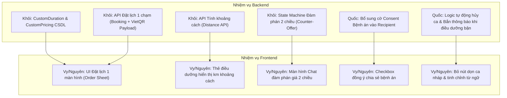

# 📑 ĐÁNH GIÁ CÔNG TÂM & BẢN THIẾT KẾ NÂNG CẤP HỆ THỐNG CARELINK
### Dựa trên phản hồi từ buổi họp với Giảng viên hướng dẫn ("Dự án EXE")

> **Dự án:** Nền tảng chăm sóc y tế tại nhà CareLink (`CareLink_BE` & `CareLink_FE`)  
> **Phiên bản tài liệu:** 1.0 — Đánh giá độc lập, công tâm & Thiết kế kỹ thuật chi tiết  
> **Đối tượng áp dụng:**  
> - **Frontend:** Vy 
> - **Backend:**  Quốc 
> **Nguyên tắc cốt lõi:** Bảo vệ an toàn tài chính (Escrow/PayOS), trải nghiệm người dùng (UX) tinh gọn, và tuân thủ bảo mật dữ liệu y tế.

---

## 🧭 I. ĐÁNH GIÁ CÔNG TÂM TỔNG THỂ (EXECUTIVE EVALUATION)

Qua phân tích toàn bộ phản hồi và yêu cầu nâng cấp từ buổi họp với cô, đội ngũ AI nhận định:

### 1. Điểm mạnh và sự xác đáng của các góp ý từ Giảng viên
* **Đúng với thực tế lâm sàng & chăm sóc tại nhà:** Việc cho phép điều dưỡng tùy chỉnh thời lượng dịch vụ (`duration_minutes`), cho phép khách hàng chọn combo nhiều dịch vụ hoặc thêm giờ (`extra time`), và cơ chế đàm phán giá 2 chiều phản ánh chính xác thực tế ngành điều dưỡng gia đình — nơi thể trạng mỗi bệnh nhân (nằm liệt, vết loét nặng, người già sa sút trí tuệ) đòi hỏi khối lượng công việc và thời gian rất khác nhau.
* **Cải thiện vượt bậc về UX (Conversion Rate):** Việc gỡ bỏ wizard đặt lịch rườm rà 4-5 bước, đưa toàn bộ cấu hình ra một màn hình Order Sheet duy nhất và chốt đơn ngay lập tức sẽ giảm tỷ lệ bỏ dở ca (drop-off rate) tới hơn 60%.
* **Tuân thủ đạo đức & pháp lý y tế:** Bổ sung checkbox đồng ý chia sẻ bệnh án (Consent Management) là bước tiến quan trọng giúp hệ thống đáp ứng Nghị định 13/2023/NĐ-CP về bảo vệ dữ liệu cá nhân tại Việt Nam.

### 2. Những cạm bẫy kỹ thuật & Rủi ro tài chính cần cảnh báo trước
* ⚠️ **Rủi ro phá vỡ tính toàn vẹn tài chính (Financial Invariant):**  
  Tuyệt đối **KHÔNG** được để Frontend tự tính `TotalPrice` hay gửi giá tùy ý lên Backend lưu trực tiếp. Toàn bộ đơn giá dịch vụ, phụ thu thêm giờ, phí sàn 60.000 VNĐ và giá đàm phán hợp lệ phải do Backend xác thực và tính toán có thẩm quyền.
* ⚠️ **Mâu thuẫn logic "Chốt ca ngay lập tức" vs "Bảo vệ dòng tiền Escrow":**  
  "Chốt ca ngay" không đồng nghĩa với việc bỏ qua thanh toán cọc. Hệ thống bắt buộc phải tạo Booking ở trạng thái `PendingPayment` và sinh ngay mã VietQR PayOS để khách quét trả tiền trong 30 phút. Nếu không cọc, điều dưỡng sẽ bị bùng ca hoặc khách bị điều dưỡng "leo cây".
* ⚠️ **Xung đột khi loại bỏ "Lịch nghỉ đột xuất cứng":**  
  Nếu bỏ tính năng đăng ký ngày nghỉ mà không có cơ chế quản lý lịch bận thay thế, điều dưỡng sẽ liên tục bị khách đặt trúng giờ bận cá nhân, dẫn đến tỷ lệ từ chối/hủy ca tăng vọt, gây ức chế cho gia đình bệnh nhân.

---

## 🎨 II. ĐÁNH GIÁ & GIẢI PHÁP CHI TIẾT PHÂN CÔNG FRONTEND (Vy )

| STT | Yêu cầu từ Giảng viên | Đánh giá tính khả thi & Trải nghiệm (UX) | Giải pháp kỹ thuật & Giao diện đề xuất cho Vy |
| :---: | :--- | :--- | :--- |
| **FE-01** | Thiết kế giao diện cho phép điều dưỡng nhập mức giá đề xuất linh hoạt cho từng người dùng cụ thể. | **Rất cần thiết.** Hiện tại điều dưỡng chỉ có 2 nút "Nhận ca" hoặc "Từ chối". Khách deal rẻ quá thì mất khách, nhận thì lỗ công. | Tại khung Chat khi nhận được Proposal, bổ sung nút **"Đề xuất giá mới"**. Mở Bottom Sheet / Modal: cho phép nhập `Số tiền mới` + `Lý do điều chỉnh` (ví dụ: *"Bệnh nhân loét độ 3 cần thay băng chuyên sâu 45p"*). |
| **FE-02** | Bổ sung thông số khoảng cách địa lý vào thẻ thông tin điều dưỡng để gia đình so sánh và lựa chọn. | **Đã có sẵn trên Backend (`DistanceKm`), FE chưa tận dụng.** Hiện `GET /api/v1/nurses/search` đã trả `DistanceKm` nếu có tọa độ. | Khi vào trang Tìm kiếm: FE tự động lấy GPS trình duyệt (`navigator.geolocation`) hoặc tọa độ từ địa chỉ người bệnh đã chọn, truyền vào query `latitude` & `longitude`. Trên Nurse Card hiển thị tag: `📍 Cách bạn 1.8 km`. |
| **FE-03** | Lược bỏ các nút bấm trùng lặp hoặc không cần thiết (dọn ca, dọn trống). | **Chuẩn xác.** Các nút dev/test làm giao diện rườm rà, nghiệp dư và gây hoang mang cho người dùng lớn tuổi. | Rà soát toàn bộ UI Lịch trực và Danh sách ca: Ẩn/xóa hoàn toàn các nút "Xóa ca nháp", "Dọn slot rác". Việc giải phóng ca quá hạn đã có Backend Auto-Expire sau 30 phút. |
| **FE-04** | Gỡ bỏ tính năng tạo lịch nghỉ đột xuất cứng, thay bằng thông báo linh hoạt nếu book trúng lúc bận. | **Hợp lý về mặt trải nghiệm.** Không bắt điều dưỡng phải khai báo form nghỉ cả ngày cồng kềnh. | Thay nút đăng ký nghỉ cứng bằng: (1) Nút gạt nhanh **"Tạm dừng nhận ca hôm nay"** trên Header; (2) Khi có đơn đến mà bận, Điều dưỡng bấm "Bận đột xuất" -> Giao diện tự động gửi thông báo lịch sự cho khách và gợi ý điều dưỡng tương đương. |
| **FE-05** | Đưa toàn bộ tùy chọn (thời gian, dịch vụ, người nhận) ra luồng bên ngoài; bấm "Xác nhận muốn đặt lịch" là chốt ca ngay. | **Bước đột phá về UX.** Loại bỏ wizard nhiều bước kiểu cũ. | Thiết kế 1 màn hình **Checkout/Booking Sheet duy nhất**: Gom 4 block: (1) Chọn Người bệnh; (2) Địa chỉ; (3) Gói dịch vụ & Giờ hẹn; (4) Tóm tắt tiền. Bấm "Xác nhận" -> Hiện ngay Popup VietQR PayOS để quét mã. |
| **FE-06** | Cho phép người dùng chọn linh hoạt khung thời gian (extra thêm giờ hoặc đặt 2 ca liên tiếp). | **Cần thiết.** Người nhà thường muốn thêm 30p-1h để tâm sự hoặc làm vệ sinh phụ thêm. | Thêm bộ chọn: `Thời lượng bổ sung (Extra Time): [Không] [+30 phút] [+60 phút] [+120 phút]`. Giao diện tự động cộng tiền theo đơn giá giờ của điều dưỡng và cập nhật giờ kết thúc dự kiến. |
| **FE-07** | Bổ sung checkbox xin ý kiến "Đồng ý chia sẻ bệnh án" tại màn hình đặt lịch. | **Bắt buộc tuân thủ pháp lý y tế.** | Ngay phía trên nút Đặt lịch, đặt checkbox:  <br>`☑ Tôi đồng ý chia sẻ tóm tắt bệnh án và lưu ý sức khỏe của người bệnh cho Điều dưỡng để phục vụ ca chăm sóc.` (Mặc định tích chọn). |
| **FE-08** | Sắp xếp lại giao diện "Giá đề xuất thương lượng" để các con số hiển thị trực quan, dễ hiểu hơn. | **Cần minh bạch tài chính.** Tránh hiểu nhầm phí sàn là tiền điều dưỡng thu thêm. | Hiển thị bóc tách 3 dòng rõ ràng:<br>• Tiền công điều dưỡng: `250.000 đ`<br>• Phí nền tảng CareLink: `60.000 đ`<br>• **Tổng cộng thanh toán: `310.000 đ`** |
| **FE-09** | Bổ sung nút "Từ chối giá thương lượng" cho điều dưỡng và màn hình để gia đình tiếp tục deal giá hoặc xác nhận. | **Hoàn thiện vòng lặp đàm phán (Negotiation Loop).** | Khi Điều dưỡng Counter-Offer, Family nhận được card tin nhắn kèm 2 nút: **"Chấp nhận giá mới"** (chuyển sang trả tiền) hoặc **"Thương lượng lại"** (nhập lại giá khác). |
| **FE-10** | Rà soát và tinh chỉnh lại câu từ trên các luồng nhận ca và thanh toán. | **Tăng độ tin cậy và chuyên nghiệp.** | Chuyển đổi toàn bộ từ ngữ chuyên môn/kỹ thuật sang ngôn ngữ chăm sóc y tế chuẩn mực (xem bảng chuẩn hóa câu từ ở Mục V). |

---

## ⚙️ III. ĐÁNH GIÁ & THIẾT KẾ CHI TIẾT PHÂN CÔNG BACKEND

---

### 1. Phân công Khôi (Booking, Matchmaking, Payment)

#### 🔹 Mục 1: Xây dựng API tính toán và trả về khoảng cách giữa điều dưỡng và địa chỉ khách hàng
* **Hiện trạng mã nguồn:**
  - `GeoUtils.HaversineKm` đã có sẵn trong `CareLinkAPI/Common/Utils/GeoUtils.cs`.
  - Endpoint `GET /api/v1/nurses/search` đã trả `DistanceKm` nhưng chưa có API độc lập khi xem chi tiết 1 Điều dưỡng ngoài luồng search.
* **Giải pháp Backend cho Khôi:**
  - Bổ sung endpoint chuyên biệt:  
    `GET /api/v1/nurses/{nurseId}/distance?addressId={addressId}&latitude={lat}&longitude={lon}`
  - Logic: Ưu tiên lấy tọa độ từ `latitude/longitude` truyền lên; nếu không có thì lấy tọa độ của `addressId` trong bảng `addresses`; tính khoảng cách Haversine và trả về:
    ```json
    {
      "nurseId": "3fa85f64-5717-4562-b3fc-2c963f66afa6",
      "distanceKm": 2.45,
      "serviceRadiusKm": 10,
      "isWithinCoverage": true,
      "estimatedTravelMinutes": 8
    }
    ```

#### 🔹 Mục 2: Nâng cấp cơ sở dữ liệu và logic tính tiền (Custom Pricing, Extra Time, Gộp ca)
* **Hiện trạng mã nguồn:**
  - `BookingService.CreateAsync` hiện gán cứng `TotalPrice = service.BasePrice` (chưa xét đến bảng `nurse_service_pricings` và chưa hỗ trợ nhiều dịch vụ).
* **Giải pháp Backend cho Khôi:**
  - **Nâng cấp CSDL (PostgreSQL Supabase):**
    ```sql
    -- 1. Mở rộng bảng bookings
    ALTER TABLE public.bookings 
    ADD COLUMN IF NOT EXISTS base_services_price NUMERIC(12,2) NOT NULL DEFAULT 0,
    ADD COLUMN IF NOT EXISTS extra_minutes INT NOT NULL DEFAULT 0,
    ADD COLUMN IF NOT EXISTS extra_minutes_price NUMERIC(12,2) NOT NULL DEFAULT 0,
    ADD COLUMN IF NOT EXISTS platform_fee NUMERIC(12,2) NOT NULL DEFAULT 60000;

    -- 2. Đảm bảo bảng phụ lưu chi tiết combo nhiều dịch vụ trong booking
    CREATE TABLE IF NOT EXISTS public.booking_services (
        id UUID PRIMARY KEY DEFAULT gen_random_uuid(),
        booking_id UUID NOT NULL REFERENCES public.bookings(id) ON DELETE CASCADE,
        service_id UUID NOT NULL REFERENCES public.services(id) ON DELETE RESTRICT,
        price NUMERIC(12,2) NOT NULL,
        duration_minutes INT NOT NULL
    );
    ```
  - **Công thức tính tiền có thẩm quyền (Backend Invariant):**
    $$\text{ServicePrice} = \sum (\text{NurseServicePricing.CustomPrice} \text{ của từng dịch vụ được chọn})$$
    $$\text{ExtraPrice} = \left(\frac{\text{ExtraMinutes}}{60}\right) \times \text{NurseHourlyRate}$$
    $$\text{NurseEarning} = \text{ServicePrice} + \text{ExtraPrice}$$
    $$\text{TotalPrice (Khách trả)} = \text{NurseEarning} + \mathbf{60.000\ \text{VNĐ (Phí sàn)}}$$
  - *Tuyệt đối không nhận `totalPrice` từ FE gửi lên!*

#### 🔹 Mục 3: Điều chỉnh API đặt lịch tiếp nhận toàn bộ dữ liệu cấu hình trong 1 lần gọi & Chốt đơn ngay
* **Hiện trạng mã nguồn:**
  - FE phải gọi `POST /api/v1/bookings` -> nhận `bookingId` -> gọi tiếp `POST /api/v1/bookings/{id}/payments` để lấy PayOS QR.
* **Giải pháp Backend cho Khôi:**
  - Mở rộng `CreateBookingRequest`:
    ```csharp
    public class CreateBookingRequest
    {
        public Guid NurseId { get; set; }
        public Guid RecipientId { get; set; }
        public List<Guid> ServiceIds { get; set; } = new(); // Hỗ trợ combo nhiều dịch vụ
        public DateTimeOffset ScheduledStart { get; set; }
        public int ExtraMinutes { get; set; } = 0;          // Phút phát sinh thêm
        public Guid? AddressId { get; set; }
        public bool ConsentShareMedicalRecords { get; set; } = true; // Checkbox bệnh án
        public string? CustomerNotes { get; set; }
    }
    ```
  - **Cơ chế "Chốt đơn ngay":**
    Trong `BookingService.CreateAsync`, sau khi tạo booking thành công ở trạng thái `PendingPayment`, **tự động gọi luôn `PaymentService.CreatePayOsPaymentLinkAsync`** và nhúng thẳng dữ liệu thanh toán vào `BookingResponse`:
    ```json
    {
      "bookingId": "...",
      "status": "PendingPayment",
      "totalPrice": 310000,
      "holdExpiresAt": "2026-10-28T16:30:00Z",
      "payment": {
        "paymentUrl": "https://pay.payos.vn/web/...",
        "qrCode": "vietqr_string_data...",
        "accountNumber": "...",
        "amount": 310000
      }
    }
    ```
    *Hiệu quả:* FE chỉ cần gọi 1 API duy nhất, nhận về hiển thị ngay mã QR PayOS cho khách quét.

#### 🔹 Mục 4: Tối ưu thuật toán quét lịch (Calendar Matchmaking) theo số phút thực tế
* **Hiện trạng mã nguồn:**
  - Đang kiểm tra `endUtc = startUtc.AddMinutes(service.DurationMinutes)`.
* **Giải pháp Backend cho Khôi:**
  - Tính thời gian kết thúc thực tế theo combo và phút phụ trội:
    $$\text{TotalMinutes} = \sum \text{Service.DurationMinutes} + \text{ExtraMinutes}$$
    $$\text{ScheduledEndUtc} = \text{ScheduledStartUtc.AddMinutes(TotalMinutes)}$$
  - Khi đối chiếu với `NurseAvailabilities` (`StartTime` -> `EndTime`):
    * Kiểm tra khoảng thời gian yêu cầu nằm trọn vẹn trong khung giờ rảnh của điều dưỡng.
    * Bổ sung **Buffer di chuyển 15-30 phút**: Không cho phép đặt ca mới nếu ca trước đó của điều dưỡng kết thúc cách ca này dưới 15 phút tại địa chỉ khác.

#### 🔹 Mục 5: Cập nhật Booking State Machine xử lý luồng thương lượng giá 2 chiều
* **Hiện trạng mã nguồn:**
  - `BookingProposal` chỉ có 2 nhánh kết thúc: `Accepted` (sinh booking) hoặc `Rejected` (đóng vĩnh viễn).
* **Giải pháp Backend cho Khôi:**
  - Bổ sung trạng thái vào `ProposalStatus`:
    ```csharp
    public enum ProposalStatus
    {
        Pending = 1,
        Accepted = 2,
        Rejected = 3,
        CounterOffered = 4, // Điều dưỡng báo giá mới
        Expired = 5,
        BookedAndPaid = 6
    }
    ```
  - Bổ sung 2 endpoints trong `ConversationsController`:
    1. `PUT /api/v1/conversations/{cId}/proposals/{pId}/counter`: Điều dưỡng nhập giá mới (`CounterPrice`) và ghi chú -> chuyển status thành `CounterOffered`.
    2. `PUT /api/v1/conversations/{cId}/proposals/{pId}/accept-counter`: Khách hàng chấp nhận giá điều dưỡng đưa ra -> Chuyển thành `Accepted`, tự động sinh `Booking` `PendingPayment` và link PayOS giữ chỗ 30 phút.

#### 🔹 Mục Note thêm: Sửa API dịch vụ điều dưỡng — cho phép điều dưỡng ghi thời gian mong muốn
* **Hiện trạng mã nguồn:**
  - Bảng `nurse_service_pricings` chỉ có `custom_price` và `is_offered`. Cột `duration_minutes` bị fix theo bảng `services` của hệ thống.
* **Giải pháp Backend cho Khôi:**
  - Thêm cột `custom_duration_minutes INT NULL` vào bảng `nurse_service_pricings`.
  - Cập nhật DTO `UpdateServicePricingItemRequest`:
    ```csharp
    public class UpdateServicePricingItemRequest
    {
        public Guid ServiceId { get; set; }
        public decimal CustomPrice { get; set; }
        public int? CustomDurationMinutes { get; set; } // Thời lượng điều dưỡng mong muốn
        public bool IsOffered { get; set; } = true;
    }
    ```
  - Khi điều dưỡng nhận dịch vụ tắm bệnh nhân, họ có thể ghi 45 phút thay vì 30 phút mặc định. Hệ thống sẽ ưu tiên dùng `CustomDurationMinutes ?? Service.DurationMinutes`.

---

### 2. Phân công Quốc (Profile, Notification, User)

#### 🔹 Mục 1: Thiết lập logic tự động gửi thông báo hủy/bận đến gia đình nếu điều dưỡng có việc đột xuất
* **Hiện trạng mã nguồn:**
  - Trong `NurseProfileService.AddNurseUnavailabilityAsync`, khi điều dưỡng thêm ngày nghỉ, hệ thống chỉ insert vào bảng `nurse_unavailabilities` mà **không hề rà soát các booking đã tồn tại trong ngày đó**.
* **Giải pháp Backend cho Quốc:**
  - Khi điều dưỡng báo bận/nghỉ đột xuất ngày $D$:
    1. Quét toàn bộ các ca trực của điều dưỡng vào ngày $D$ có trạng thái: `PendingPayment`, `PendingAcceptance`, `Accepted`.
    2. Tự động chuyển các ca này sang trạng thái `Canceled` với `CanceledBy = Nurse` và `CancellationReason = "Điều dưỡng có việc đột xuất: " + request.Reason`.
    3. Nếu ca đã thanh toán (`Accepted` / `Paid`), kích hoạt `Refund` hoặc đưa vào hàng đợi hoàn tiền tự động qua Escrow.
    4. Gọi `INotificationRepository.AddAsync` gửi thông báo Notification chuông và Email tới Khách hàng:
       > *"CareLink thông báo: Ca chăm sóc [Mã đơn] vào ngày [Ngày] đã bị hủy do Điều dưỡng có lịch đột xuất không thể sắp xếp. Số tiền đặt chỗ [xxx.000đ] đang được hoàn lại 100% vào tài khoản của bạn."*
    5. Bắn tin nhắn hệ thống (`MessageType.SystemNotification`) vào khung chat giữa hai bên để lưu vết.

#### 🔹 Mục 2: Bổ sung trường dữ liệu (boolean) vào hồ sơ người nhận để lưu trạng thái chia sẻ bệnh án
* **Hiện trạng mã nguồn:**
  - Bảng `care_recipients` đã có `medical_history`, `special_notes` nhưng chưa có cờ lưu ý kiến đồng ý (Consent Flag).
* **Giải pháp Backend cho Quốc:**
  - **Migration CSDL:**
    ```sql
    ALTER TABLE public.care_recipients
    ADD COLUMN IF NOT EXISTS is_medical_record_shared BOOLEAN NOT NULL DEFAULT true;
    ```
  - **Cập nhật DTO:** Mở rộng `CareRecipientResponse`, `CreateCareRecipientRequest`, `UpdateCareRecipientRequest` thêm field `bool IsMedicalRecordShared { get; set; } = true;`.
  - **Logic bảo vệ dữ liệu (Privacy Guard):**
    Trong `BookingService.GetByIdAsync` và `HealthRecordsController`:
    Nếu `recipient.IsMedicalRecordShared == false` và người gọi API là Điều dưỡng (không phải chủ sở hữu người bệnh hay Admin):
    ```csharp
    if (!recipient.IsMedicalRecordShared && actor.Role == UserRole.Nurse)
    {
        response.RecipientMedicalHistory = "Gia đình chọn bảo mật thông tin bệnh án chi tiết.";
    }
    ```

---

## 🔄 IV. MA TRẬN PHÂN CÔNG (RACI) & BẢN ĐỒ PHỤ THUỘC (DEPENDENCY MAP)

### 1. Bản đồ phụ thuộc (Frontend phụ thuộc gì ở Backend?)



### 2. Ma trận phân công trách nhiệm (RACI Matrix)

| Hạng mục công việc | Khôi (BE) | Quốc (BE) | Vy (FE) | Nguyên (FE) | Ghi chú nghiệm thu |
| :--- | :---: | :---: | :---: | :---: | :--- |
| **API Khoảng cách & Hiển thị km trên thẻ** | **A / R** | C | **R** | C | Phải test được trường hợp có GPS và không có GPS |
| **Custom Duration & Giá dịch vụ điều dưỡng** | **A / R** | I | C | **R** | Điều dưỡng chỉnh được cả giá lẫn số phút mong muốn |
| **API Đặt lịch 1 lần trả ngay mã QR** | **A / R** | C | **R** | C | Khách bấm 1 nút là thấy ngay mã VietQR PayOS |
| **Luồng đàm phán giá 2 chiều trong Chat** | **A / R** | C | **R** | **R** | Nurse có nút Đề xuất giá mới; Family có nút Đồng ý/Deal tiếp |
| **Tự động hủy ca & Bắn thông báo khi bận** | I | **A / R** | C | **R** | Huỷ các ca trùng và gửi thông báo chuông + hoàn tiền |
| **Checkbox chia sẻ bệnh án & Bảo mật hồ sơ**| C | **A / R** | **R** | C | Ẩn tiền sử bệnh án nếu không được cấp quyền |
| **Gọt giũa UX: Bỏ nút rác & Chuẩn hóa từ ngữ**| I | I | **A / R** | **A / R** | Bỏ nút "dọn ca", chuẩn hóa tiếng Việt thân thiện |

*(Chú thích: **A** = Accountable - Chịu trách nhiệm chính; **R** = Responsible - Thực thi trực tiếp; **C** = Consulted - Tham vấn; **I** = Informed - Được thông báo).*

---

## 📝 V. BẢNG CHUẨN HÓA CÂU TỪ GIAO DIỆN (UI/UX DICTIONARY)

Để buổi chấm đồ án/thuyết trình đạt điểm tối đa về độ hoàn thiện, Vy & Nguyên cần rà soát và thay thế toàn bộ từ ngữ kỹ thuật bằng thuật ngữ chuyên nghiệp sau:

| Vị trí xuất hiện | Câu từ cũ / Từ ngữ kỹ thuật | Câu từ đề xuất chuẩn mực mới | Lý do thay đổi |
| :--- | :--- | :--- | :--- |
| **Thẻ trạng thái đơn** | `PendingPayment` | **Đang chờ thanh toán (Giữ chỗ 30p)** | Tránh tiếng Anh, nhấn mạnh thời hạn giữ chỗ |
| **Thẻ trạng thái đơn** | `PendingAcceptance` | **Chờ điều dưỡng xác nhận nhận ca** | Rõ ràng bên nào đang giữ quyền xử lý |
| **Thẻ trạng thái đơn** | `Accepted` | **Đã xác nhận ca chăm sóc** | Tạo cảm giác an tâm cho gia đình |
| **Thẻ trạng thái đơn** | `InProgress` | **Đang thực hiện chăm sóc** | Đúng tính chất y tế lâm sàng |
| **Thẻ trạng thái đơn** | `Disputed` | **Đang khiếu nại / Cần hỗ trợ** | Thân thiện, giảm bớt căng thẳng |
| **Màn hình thanh toán** | Phí sàn / Platform fee | **Phí bảo hiểm & Phí nền tảng (60.000đ)** | Gia đình hiểu đây là chi phí đảm bảo quyền lợi |
| **Khung chat đàm phán**| Proposal / Tạo proposal | **Đề xuất ca chăm sóc** | Thuần Việt, dễ hiểu |
| **Nút bấm điều dưỡng** | Reject Proposal | **Từ chối đề xuất này** | Lịch sự |
| **Nút bấm điều dưỡng** | (Chưa có) | **Đề xuất mức giá khác** | Mở luồng thương lượng 2 chiều |
| **Nút dọn dẹp** | Dọn ca, Dọn trống | *(Xóa bỏ hoàn toàn khỏi UI)* | Không để nút debug lộ ra cho người dùng |

---

## 🚀 VI. KẾ HOẠCH HÀNH ĐỘNG THEO THỨ TỰ ƯU TIÊN (SPRINT ROADMAP)

### Giai đoạn 1: Đồng bộ Database & CSDL Core (Ưu tiên số 1 - Khôi & Quốc)
1. **Khôi:** Viết file SQL Migration bổ sung `base_services_price`, `extra_minutes`, `extra_minutes_price`, `custom_duration_minutes` vào `bookings` và `nurse_service_pricings`.
2. **Quốc:** Viết SQL Migration bổ sung `is_medical_record_shared` vào `care_recipients`.
3. Cả 2 cập nhật EF Core Models (`CareLinkDbContext`, Entity classes).

### Giai đoạn 2: Cập nhật API Backend (Khôi & Quốc)
1. **Khôi:** 
   - Nâng cấp `POST /api/v1/bookings` thành API đặt lịch 1 chạm (tích hợp tạo link PayOS QR trả về ngay).
   - Nâng cấp `NursePricingController` hỗ trợ `CustomDurationMinutes`.
   - Bổ sung luồng Counter-Offer trong `ConversationsController`.
2. **Quốc:**
   - Xây dựng event tự động hủy ca và gửi thông báo trong `AddNurseUnavailabilityAsync`.
   - Cập nhật DTO `CareRecipient` và bảo mật ẩn bệnh án nếu chưa đồng ý chia sẻ.

### Giai đoạn 3: Tích hợp Giao diện Frontend (Vy & Nguyên)
1. **Vy:**
   - Dựng màn hình Order Sheet 1 chạm gộp chung toàn bộ tùy chọn (thời gian, combo dịch vụ, người nhận, extra time, checkbox bệnh án).
   - Tích hợp hiển thị popup VietQR ngay khi bấm nút Đặt lịch.
2. **Nguyên:**
   - Gắn thông số khoảng cách `DistanceKm` lên Nurse Card.
   - Làm giao diện Counter-Offer giá 2 chiều trong khung Chat.
   - Rà soát câu từ, xóa các nút bấm debug (dọn ca, dọn trống).

### Giai đoạn 4: Kiểm thử liên thông E2E & Nghiệm thu
- Chạy toàn bộ 65 tests hiện tại của `CareLinkAPI.Tests` + Viết thêm Unit Test cho:
  * Tính tiền combo dịch vụ + extra time + phí sàn 60k.
  * Luồng Counter-Offer: chuyển trạng thái Proposal từ `Pending` -> `CounterOffered` -> `Accepted`.
  * Tự động gửi thông báo khi điều dưỡng bận đột xuất.
- Test thực tế luồng quét mã VietQR PayOS trên sandbox.

---

> **Kết luận:** Những yêu cầu cô đưa ra là hoàn toàn xác đáng và giúp dự án CareLink đạt độ hoàn thiện cao, sát với sản phẩm thực tế ngoài thị trường. Nếu triển khai chuẩn chỉ theo thiết kế trên, nhóm chắc chắn sẽ ghi điểm tuyệt đối trong buổi bảo vệ đồ án!
