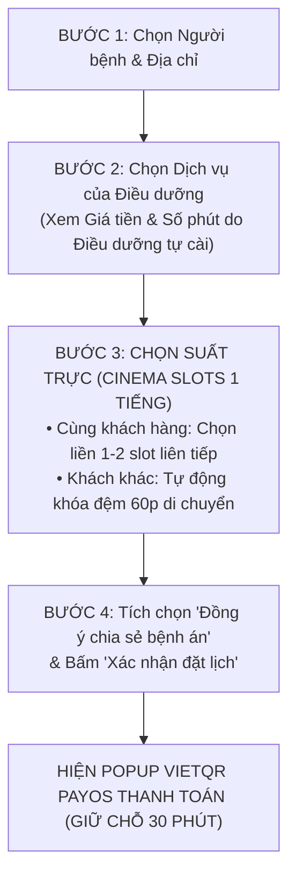
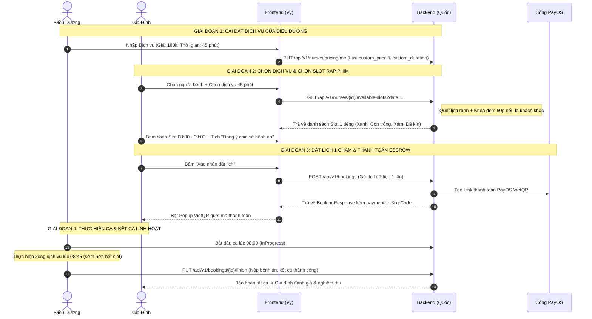

# 📑 ĐÁNH GIÁ CÔNG TÂM & BẢN THIẾT KẾ NÂNG CẤP HỆ THỐNG CARELINK (V2.0)
### Dựa trên phản hồi từ Giảng viên hướng dẫn & Thống nhất mô hình Booking "Đặt vé xem phim"

> **Dự án:** Nền tảng chăm sóc y tế tại nhà CareLink (`CareLink_BE` & `CareLink_FE`)  
> **Phiên bản tài liệu:** 2.0 — Tích hợp mô hình Slot 1 tiếng, Khóa đệm 60p, Dịch vụ hoàn tất & Thông báo bận linh hoạt  
> **Phân công trách nhiệm:**  
> - **Frontend:** Vy  
> - **Backend:** Quốc  
> **Nguyên tắc cốt lõi:** Bảo vệ an toàn tài chính (Escrow PayOS), trải nghiệm đặt lịch trực quan (Cinema-Style UX), và chuẩn mực bảo mật dữ liệu y tế.

---

## 🧭 I. ĐÁNH GIÁ CÔNG TÂM TỔNG THỂ (EXECUTIVE EVALUATION)

Qua phân tích phản hồi từ Giảng viên hướng dẫn và các trao đổi kiến trúc chuyên sâu, đội ngũ thống nhất 5 nhận định cốt lõi:

1. **Bước chuyển dịch lớn: Chuyển sang mô hình Slot 1 tiếng (Atomic 1-Hour Slot) dạng "Đặt vé xem phim"**
   - Loại bỏ hoàn toàn việc gia đình tự gõ giờ tự do gây lẹm ca, vỡ lịch.
   - Chia sẵn các slot chuẩn 1 tiếng. Khách cần 1 tiếng thì chọn 1 ô; cần 2 tiếng hoặc thêm giờ thì chọn 2 ô liên tiếp (như chọn 2 ghế cạnh nhau trong rạp phim).
2. **Quy tắc đệm di chuyển 60 phút (Travel Buffer 60m):**
   - Giữa 2 khách hàng khác nhau: Hệ thống **tự động khóa 60 phút di chuyển tiếp theo**. Đảm bảo điều dưỡng có đủ 1 tiếng để thu dọn đồ nghề vô khuẩn, di chuyển xe máy, chống kẹt xe đô thị và chuẩn bị tinh thần cho ca tiếp theo.
3. **Bản chất ca trực: Tính theo Bảng dịch vụ hoàn tất (Service-based Completion), KHÔNG tính theo slot giờ cứng:**
   - Dịch vụ y tế tại nhà đo lường bằng **chất lượng quy trình chuyên môn**, không phải bằng việc "ngồi canh đồng hồ cho hết giờ". Điều dưỡng làm xong đúng quy trình, gia đình nghiệm thu là được kết thúc ca, nộp bệnh án và ra về.
4. **Bỏ tính năng "Tạo lịch nghỉ đột xuất cứng" (No Rigid Blackout Form):**
   - Thay bằng cơ chế **Báo bận & Thông báo linh hoạt**: Khi khách lỡ book trúng lúc điều dưỡng có việc bận, điều dưỡng bấm từ chối -> Hệ thống tự động hoàn tiền 100%, gửi thông báo xin lỗi chu đáo và gợi ý điều dưỡng khác cùng quận cho gia đình.
5. **Điều dưỡng tự định đoạt [Giá tiền] kèm [Thời gian mong muốn]:**
   - Hệ thống không ép thời gian cứng của Admin. Điều dưỡng tự ước tính tay nghề của mình: dịch vụ này làm bao nhiêu phút với giá bao nhiêu.

---

## 🎬 II. KIẾN TRÚC BOOKING MỚI: "ĐẶT VÉ XEM PHIM" (CINEMA-STYLE SLOT PICKER)

### 1. Quy tắc hiển thị lưới Ca trực (Slot Grid)
Mỗi ngày làm việc của Điều dưỡng được chia thành các slot chuẩn **1 tiếng (60 phút)**:
- `Slot 1:` 08:00 – 09:00
- `Slot 2:` 09:00 – 10:00
- `Slot 3:` 10:00 – 11:00
- `Slot 4:` 11:00 – 12:00
- *(Nghỉ trưa: 12:00 – 13:30)*
- `Slot 5:` 13:30 – 14:30
- `Slot 6:` 14:30 – 15:30
- `Slot 7:` 15:30 – 16:30
- `Slot 8:` 16:30 – 17:30

Chỗ này cho thời gian từ 6h đến 22h đi ko cần nghỉ trưa

### 2. Thuật toán khóa đệm di chuyển 60 phút (Travel Buffer Algorithm)
* **Kịch bản 1: CÙNG MỘT KHÁCH HÀNG (Đặt gộp ca / Thêm giờ):**
  - Khách hàng chọn dịch vụ cần 90 phút hoặc muốn điều dưỡng nán lại trông cụ thêm 1 tiếng -> Khách tick chọn liền 2 slot: `[08:00 - 09:00]` và `[09:00 - 10:00]`.
  - Hệ thống cho phép gộp liền kề vì không phát sinh di chuyển giữa 2 địa chỉ.
* **Kịch bản 2: HAI KHÁCH HÀNG KHÁC NHAU:**
  - Nếu Khách A đã chốt đặt ca `[08:00 - 09:00]`:
  - Hệ thống **TỰ ĐỘNG KHÓA 60 PHÚT TIẾP THEO (`09:00 - 10:00`) LÀM THỜI GIAN DI CHUYỂN**.
  - Khách B khi vào xem lịch chỉ thấy slot sớm nhất có thể đặt là từ **`10:00 - 11:00`** trở đi.
  - *Ý nghĩa thực tế:* Đảm bảo 100% điều dưỡng không bị trễ hẹn, không bị stress vì kẹt xe, có đủ thời gian vệ sinh sát khuẩn đồ nghề trước khi đến nhà bệnh nhân mới.

---

## ⏱️ III. LÝ GIẢI NGHIỆP VỤ: KẾT THÚC CA & CƠ CHẾ TÍNH TIỀN

### 1. Tại sao vẫn còn trong slot giờ mà Điều dưỡng được phép kết thúc ca?
> **Ghi chú nghiệp vụ quan trọng:** Ca chăm sóc y tế được tính theo **Gói Dịch vụ hoàn tất (Service/Task-based Completion)**, KHÔNG tính theo "chấm công ngồi đếm giờ" (Timecard-based).

* **Ví dụ thực tế:**
  - Khách book slot 1 tiếng `08:00 - 09:00` cho dịch vụ *"Thay băng rửa vết thương chuyên sâu"*.
  - Trong bảng giá cá nhân, Điều dưỡng đã cài đặt thời gian ước tính là **45 phút**.
  - Điều dưỡng đến lúc 08:00, thực hiện đầy đủ quy trình chuyên môn vô khuẩn, đo huyết áp, thay băng xong lúc **08:45**. Người nhà kiểm tra vết thương hài lòng.
* **Quyền kết ca:**
  - Điều dưỡng **hoàn toàn có quyền bấm "Hoàn tất ca" lúc 08:45** và nộp Báo cáo chăm sóc/bệnh án.
  - **15 phút còn lại của slot (08:45 - 09:00) là khoảng đệm an toàn**, được dùng để:
    1. Thu dọn rác thải y tế, thu hồi dụng cụ vô trùng vào hộp chuyên dụng.
    2. Dặn dò người nhà cách dùng thuốc và chế độ ăn uống.
    3. Rửa tay sát khuẩn, chỉnh trang tư trang trước khi rời khỏi nhà.
  - Khách hàng không bị tính thêm tiền và Điều dưỡng không bị coi là "về sớm bỏ ca" vì gói dịch vụ đã hoàn thành 100% chất lượng.

### 2. Cơ chế tính tiền: Theo Bảng giá Dịch vụ, không tính theo slot
* Khách thanh toán đúng số tiền của các dịch vụ đã chọn (theo bảng giá riêng của điều dưỡng) + 60.000 VNĐ phí sàn CareLink.
* Slot 1 tiếng chỉ là **khung thời gian giữ chỗ (Time Window Allocation)** trên lịch trực, không dùng làm hệ số nhân tiền (trừ khi khách chủ động chọn thêm dịch vụ `Extra Time`).

---

## 🚫 IV. THAY THẾ "LỊCH NGHỈ ĐỘT XUẤT CỨNG" BẰNG "THÔNG BÁO BẬN LINH HOẠT"

### 1. Vì sao bỏ "Lịch nghỉ đột xuất cứng" (Blackout Date Form)?
- Form đăng ký nghỉ cả ngày cứng nhắc khiến điều dưỡng nếu chỉ bận 1-2 tiếng việc riêng thì bị khóa mất cả ngày, vừa mất thu nhập vừa mất khách quen.
- Khi điều dưỡng bấm nghỉ, các ca khách đã đặt trước đó bị treo không được xử lý tự động, gây bức xúc cho gia đình.

### 2. Cơ chế mới: "Báo bận & Tự động thông báo hoàn tiền linh hoạt"
Khi gia đình lỡ book vào khung giờ mà Điều dưỡng bận việc đột xuất:
1. **Thao tác Điều dưỡng:** Điều dưỡng nhận được yêu cầu ca, bấm nút **"Báo bận đột xuất"** -> Chọn lý do nhanh: `[Có ca cấp cứu khác]` / `[Việc gia đình gấp]` / `[Sức khỏe không đảm bảo]`.
2. **Xử lý Backend tự động:**
   - Đổi trạng thái Booking sang `Canceled` với `CanceledBy = Nurse`.
   - Nếu khách đã thanh toán PayOS: Hệ thống tự động kích hoạt **hoàn tiền 100% (Refund)** qua Escrow PayOS ngay lập tức.
   - Slot giờ đó được giải phóng.
3. **Trải nghiệm Gia đình (Notification & Smart Suggestion):**
   - Hệ thống bắn Notification chuông + Tin nhắn thông báo:
     > *"CareLink thông báo: Rất tiếc, Điều dưỡng [Tên] có lịch bận đột xuất ([Lý do]) nên không thể nhận ca ngày [Ngày, Giờ]. Số tiền [xxx.000đ] đã được hoàn lại 100% vào tài khoản của bạn."*
   - Ngay bên dưới thông báo, giao diện hiển thị 1 Bottom Sheet: **"Gợi ý Điều dưỡng thay thế tương đương"** (tự động lọc các điều dưỡng cùng chuyên môn, có cùng khung giờ rảnh và ở gần địa chỉ của khách). Khách chỉ cần 1 chạm để chuyển đơn sang điều dưỡng mới mà không cần tìm kiếm lại từ đầu.

---

## 👩‍💻 V. PHÂN CÔNG CHI TIẾT FRONTEND (Vy)

| STT | Mã việc | Tên chức năng | Chi tiết màn hình & Trải nghiệm (UX) cần làm |
| :---: | :---: | :--- | :--- |
| 1 | **FE-01** | **Màn hình Điều dưỡng cài đặt Dịch vụ** | Bổ sung 2 ô nhập cho mỗi dịch vụ nhận làm: **[Giá tiền riêng (VNĐ)]** VÀ **[Thời lượng dự kiến (phút)]** (ví dụ: 45p, 60p, 90p). Không hiển thị thời gian fix cứng của Admin nữa. |
| 2 | **FE-02** | **Lưới chọn ca kiểu Vé xem phim (Cinema Slot Picker)** | Hiển thị các ô slot 1 tiếng (`08:00-09:00`, `09:00-10:00`...). Ô trống: màu xanh; Ô kín/đệm di chuyển: làm mờ màu xám. Cho phép chạm chọn 1 hoặc nhiều ô liên tiếp. |
| 3 | **FE-03** | **Order Sheet 1 chạm gộp chung** | Thiết kế 1 màn hình Checkout duy nhất gồm: (1) Người bệnh; (2) Địa chỉ; (3) Combo dịch vụ; (4) Lưới chọn ca rạp phim; (5) Checkbox bệnh án; (6) Nút "Xác nhận đặt lịch" -> Mở ngay Popup VietQR PayOS. |
| 4 | **FE-04** | **Thẻ Điều dưỡng hiển thị khoảng cách km** | Lấy GPS trình duyệt (`navigator.geolocation`) hoặc tọa độ từ địa chỉ người bệnh để truyền vào query search. Hiển thị tag: `📍 Cách bạn 1.8 km`. |
| 5 | **FE-05** | **Giao diện Chat đàm phán giá 2 chiều (Counter-Offer)** | Điều dưỡng có nút **"Đề xuất giá mới"** (nhập số tiền + lý do). Phía gia đình nhận được Card có 2 nút: **"Chấp nhận giá mới"** (đi thanh toán) hoặc **"Deal tiếp"**. |
| 6 | **FE-06** | **Checkbox "Đồng ý chia sẻ bệnh án"** | Đặt trước nút Xác nhận đặt lịch: `☑ Tôi đồng ý chia sẻ tóm tắt bệnh án cho Điều dưỡng phụ trách ca này.` |
| 7 | **FE-07** | **Bỏ nút rác & Giao diện Thông báo bận** | • Xóa sạch các nút dev cũ (dọn ca, dọn trống). • Dựng modal hiển thị thông báo khi điều dưỡng báo bận kèm nút xem danh sách điều dưỡng gợi ý thay thế. |
| 8 | **FE-08** | **Chuẩn hóa câu từ giao diện y tế** | Rà soát toàn bộ UI thay thuật ngữ kỹ thuật bằng tiếng Việt chuyên nghiệp (theo bảng Mục VII). |

---

## 👨‍💻 VI. PHÂN CÔNG CHI TIẾT BACKEND (Quốc)

| STT | Mã việc | Tên chức năng | Chi tiết kỹ thuật CSDL, API & Logic nghiệp vụ cần làm |
| :---: | :---: | :--- | :--- |
| 1 | **BE-01** | **CSDL Cấu hình Dịch vụ Điều dưỡng** | Thêm cột `custom_duration_minutes INT NOT NULL DEFAULT 60` vào bảng `nurse_service_pricings`. Cập nhật `UpdateNurseServicePricingRequest` để điều dưỡng lưu cả Giá và Số phút mong muốn. |
| 2 | **BE-02** | **API Sinh Slot Ca trực rạp phim & Khóa đệm 60p** | Xây dựng API: `GET /api/v1/nurses/{nurseId}/available-slots?date=YYYY-MM-DD&customerId={id}`:  • Chia ca theo nhịp 1 tiếng. • Quét các ca đã đặt: nếu là của khách khác, **tự động đánh dấu khóa thêm 60 phút tiếp theo** làm buffer di chuyển. • Trả về mảng: `[{ "startTime": "08:00", "endTime": "09:00", "isAvailable": true }, ...]`. |
| 3 | **BE-03** | **API Đặt lịch 1 chạm trả ngay mã QR PayOS** | Nâng cấp `POST /api/v1/bookings`: Tiếp nhận danh sách `ServiceIds`, `SlotTimes`, `AddressId`, `IsConsentShared`. Tạo booking `PendingPayment` và gọi luôn `PaymentService` để trả về ngay URL/VietQR trong response duy nhất. |
| 4 | **BE-04** | **Logic Kết ca theo Dịch vụ (Không theo slot)** | Cập nhật `BookingService.FinishAsync`: Cho phép Điều dưỡng bấm hoàn tất ca khi đã làm xong dịch vụ y tế, nộp bệnh án (dù thời gian thực tế sớm hơn thời gian kết thúc của slot). Lưu chính xác `actual_finished_at`. |
| 5 | **BE-05** | **Logic Báo bận linh hoạt & Tự động hoàn tiền** | Nâng cấp `PUT /api/v1/bookings/{id}/reject`: Điều dưỡng chọn lý do bận -> Chuyển status `Canceled`, kích hoạt hoàn tiền tự động qua Escrow PayOS, tạo notification chuông cho gia đình và gợi ý danh sách điều dưỡng tương đương cùng quận. |
| 6 | **BE-06** | **State Machine Đàm phán giá 2 chiều trong Chat** | Mở rộng `ProposalStatus` thêm `CounterOffered`. Thêm API: `PUT .../proposals/{id}/counter` (Điều dưỡng báo giá lại) và `PUT .../proposals/{id}/accept-counter` (Khách chấp thuận giá mới). |
| 7 | **BE-07** | **Bảo mật dữ liệu bệnh án (Consent Flag)** | Thêm cột `is_medical_record_shared` vào `care_recipients` (và snapshot vào `bookings`). Nếu khách không tích đồng ý: ẩn tiền sử bệnh án chi tiết khi Điều dưỡng gọi API xem hồ sơ. |
| 8 | **BE-08** | **API Tính khoảng cách độc lập** | Tạo endpoint `GET /api/v1/nurses/{nurseId}/distance?addressId={id}&latitude={lat}&longitude={lon}` sử dụng công thức Haversine có sẵn trong `GeoUtils.cs`. |

---

## 📝 VII. BẢNG CHUẨN HÓA CÂU TỪ GIAO DIỆN (UI/UX DICTIONARY)

| Vị trí xuất hiện | Câu từ kỹ thuật cũ | Câu từ tiếng Việt chuẩn mực mới | Ý nghĩa người dùng |
| :--- | :--- | :--- | :--- |
| **Trạng thái đơn** | `PendingPayment` | **Đang chờ thanh toán (Giữ chỗ 30p)** | Rõ ràng về thời hạn giữ chỗ |
| **Trạng thái đơn** | `PendingAcceptance` | **Chờ điều dưỡng xác nhận nhận ca** | Minh bạch bên chịu trách nhiệm |
| **Trạng thái đơn** | `Accepted` | **Đã xác nhận ca chăm sóc** | Tạo cảm giác an tâm |
| **Trạng thái đơn** | `InProgress` | **Đang thực hiện chăm sóc** | Đúng tính chất y tế lâm sàng |
| **Màn hình thanh toán** | Phí sàn / Platform fee | **Phí bảo hiểm & Phí nền tảng (60.000đ)** | Gia đình hiểu đây là quyền lợi bảo hiểm |
| **Màn hình đàm phán** | Proposal | **Đề xuất ca chăm sóc** | Thuần Việt, dễ hiểu |
| **Nút bấm điều dưỡng** | Reject Proposal | **Từ chối đề xuất này** | Lịch sự |
| **Nút bấm điều dưỡng** | (Chưa có) | **Đề xuất mức giá khác** | Mở luồng đàm phán 2 chiều |
| **Lịch điều dưỡng** | Dọn ca, Dọn trống | *(Xóa bỏ hoàn toàn khỏi UI)* | Xóa dấu vết debug |
| **Lưới chọn ca** | Slots | **Khung giờ / Suất trực khả dụng** | Giống rạp chiếu phim |

---

## 🔄 VIII. BẢN ĐỒ TƯƠNG TÁC GIỮA VY (FE) VÀ QUỐC (BE)

---

## 🚀 IX. KẾ HOẠCH TRIỂN KHAI THEO GIAI ĐOẠN

### Giai đoạn 1: Cơ sở dữ liệu & Cấu hình dịch vụ (Quốc thực hiện trước)
1. Viết Migration Supabase:
   - Thêm `custom_duration_minutes` vào `nurse_service_pricings`.
   - Thêm `is_medical_record_shared` vào `care_recipients`.
   - Thêm `base_services_price`, `extra_minutes`, `platform_fee` vào `bookings`.
2. Nâng cấp DTO `UpdateNurseServicePricingRequest` để Điều dưỡng lưu thời gian mong muốn.

### Giai đoạn 2: API Lịch rảnh rạp phim & Khóa đệm di chuyển 60p (Quốc)
1. Viết API `GET /api/v1/nurses/{id}/available-slots` tự động sinh các slot 1 tiếng và áp dụng rule: **Khóa đệm 60 phút giữa 2 khách hàng khác nhau**.
2. Nâng cấp `POST /api/v1/bookings` thành API đặt lịch 1 chạm (sinh luôn link VietQR PayOS trong response).

### Giai đoạn 3: Tích hợp Giao diện người dùng (Vy)
1. Dựng Order Sheet 1 chạm: tích hợp bộ chọn dịch vụ + lưới slot 1 tiếng rạp phim + checkbox bệnh án.
2. Hiển thị Popup VietQR quét mã giữ chỗ 30 phút.
3. Làm giao diện Counter-Offer giá 2 chiều trong khung Chat.
4. Xóa bỏ form đăng ký nghỉ cứng, thay bằng modal thông báo khi điều dưỡng báo bận.

### Giai đoạn 4: Kiểm thử E2E & Báo cáo Giảng viên
- Kiểm tra tính toán tiền: Đơn giá riêng của điều dưỡng + Phí sàn 60.000đ.
- Kiểm tra kịch bản khóa đệm 60p: Khách A book 08:00 - 09:00 -> Khách B chỉ thấy slot từ 10:00 trở đi.
- Kiểm tra kết ca linh hoạt: Dịch vụ 45p kết ca lúc 08:45 thành công.

---

> **Tài liệu tham chiếu:** [DOCUMENTATION_INDEX.md](file:///d:/Documents/EXE1/CareLink_BE/docs/ai/DOCUMENTATION_INDEX.md)  
> **Trạng thái:** `ACTIVE / PROPOSAL APPROVED` — Sẵn sàng triển khai vào mã nguồn.
