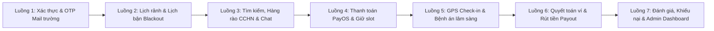

# 🎬 KỊCH BẢN LIVE DEMO THUYẾT TRÌNH TRỌN VẸN 7 LUỒNG CARELINK
> **Dành cho:** Báo cáo Đồ án / Thẩm định Sản phẩm (EXE / Capstone)  
> **Cam kết:** Bao quát **100% đầy đủ 7 Luồng nghiệp vụ** từ Onboarding $\rightarrow$ Lịch làm việc $\rightarrow$ Khớp lịch $\rightarrow$ Thanh toán PayOS $\rightarrow$ Khám & Check-in GPS $\rightarrow$ Quyết toán ví $\rightarrow$ Khiếu nại & Admin Dashboard.  
> **Thời lượng Demo:** 6 – 8 phút thao tác mượt mà trên giao diện Web / App.

---

## 🗺️ TỔNG QUAN HÀNH TRÌNH DEMO TRỌN VẸN 7 LUỒNG

---

## 👥 PHÂN VAI & CHUẨN BỊ TÀI KHOẢN TRƯỚC KHI BẮT ĐẦU

Để demo mượt mà trong 8 phút mà không phải đăng xuất/đăng nhập liên tục, bạn hãy mở sẵn **3 cửa sổ trình duyệt**:
1. **Cửa sổ 1 (Trình duyệt thường):** Tài khoản **Khách hàng** (Customer - Gia đình người bệnh).
2. **Cửa sổ 2 (Trình duyệt Ẩn danh - Incognito):** Tài khoản **Điều dưỡng / Sinh viên Y** (Nurse/Caregiver).
3. **Cửa sổ 3 (Trình duyệt thứ hai - Edge/Brave):** Tài khoản **Quản trị viên** (Admin Backoffice).

---

# 🚀 KỊCH BẢN THAO TÁC & LỜI THOẠI CHI TIẾT TRỌN VẸN 7 LUỒNG

---

### 🟢 MÀN 1: LUỒNG 1 - XÁC THỰC DANH TÍNH & ONBOARDING (NURSE VERIFICATION)
> **Mục tiêu chứng minh:** Đột phá phân loại Sinh viên Y khoa vs Điều dưỡng chính quy, ngăn chặn làm giả bằng cấp qua cơ chế OTP Email trường `.edu.vn`.

* **Thao tác 1 (Cửa sổ Điều dưỡng):** Vào màn hình Xác thực hồ sơ (`/caregiver/verification`).
* **Lời thoại dẫn dắt:**
  > *"Em xin bắt đầu với Luồng 1: Đăng ký và Xác thực hồ sơ Điều dưỡng.  
  > Trên màn hình, hệ thống cho phép chọn 2 loại hình: **Điều dưỡng tốt nghiệp** hoặc **Sinh viên Y khoa**.  
  > Khi em chọn **Sinh viên Y khoa**, hệ thống tự động ẩn yêu cầu Chứng chỉ hành nghề và kích hoạt cơ chế bảo mật: **Xác thực qua Hòm thư trường cấp đuôi `.edu.vn` hoặc `.edu`**."*

* **Thao tác 2:** Nhập email sinh viên (ví dụ: `vynntse183571@fpt.edu.vn` hoặc `@ump.edu.vn`), bấm nút **"Gửi mã OTP"**. Sau đó nhập mã 6 số và bấm **"Xác nhận OTP"**.
* **Lời thoại dẫn dắt:**
  > *"Em bấm 'Gửi mã OTP'. Backend kiểm tra đúng tên miền đại học y/dược, băm mã BCrypt và gửi OTP 6 số về hộp thư trường. Em nhập mã OTP và nhận được tích xanh **'Đã xác minh Email trường'**. Nếu chưa qua bước này, hệ thống chặn 100% không cho nộp hồ sơ."*

* **Thao tác 3 (Chuyển sang Cửa sổ Admin):** Mở màn hình Quản trị duyệt hồ sơ (`/admin/verifications`). Nhấn xem hồ sơ vừa nộp và bấm **"Phê duyệt (Approve)"**.
* **Lời thoại dẫn dắt:**
  > *"Phía Admin: Quản trị viên đối soát CCCD với Thẻ sinh viên đã được xác thực email trường và bấm duyệt. Lúc này tài khoản chính thức được kích hoạt trên sàn."*

---

### 🟢 MÀN 2: LUỒNG 2 - CẤU HÌNH ĐỊA BÀN, LỊCH LÀM VIỆC & LỊCH BẬN ĐỘT XUẤT
> **Mục tiêu chứng minh:** Giải quyết bài toán trùng lịch và điều dưỡng bỏ ca bằng Lịch bận đột xuất (Blackout Dates) và Nút gạt nhận ca.

* **Thao tác 1 (Cửa sổ Điều dưỡng):** Mở trang Hồ sơ & Lịch làm việc (`/caregiver/schedule`).
* **Lời thoại dẫn dắt:**
  > *"Sang Luồng 2: Điều dưỡng thiết lập vùng hoạt động và lịch rảnh.  
  > Điều dưỡng ghim vị trí nhà, cài đặt bán kính phục vụ là 10km và cài lịch rảnh cố định trong tuần."*

* **Thao tác 2:** Thao tác bật/tắt công tắc **"Sẵn sàng nhận ca (Accepting Bookings)"**. Sau đó chuyển sang mục **"Lịch bận đột xuất (Blackout Dates)"**, chọn 1 ngày (ví dụ thứ Bảy tuần này) và bấm **Thêm ngày bận**.
* **Lời thoại dẫn dắt:**
  > *"Đặc biệt, CareLink giải quyết triệt để vấn đề điều dưỡng nhận đơn rồi hủy bằng 2 tính năng:  
  > 1. Công tắc Online/Offline: Gạt tắt khi bận việc đột xuất để ẩn khỏi kết quả tìm kiếm.  
  > 2. Tính năng **Blackout Dates**: Đăng ký ngày bận thi cử, hệ thống tự động khóa ngày này, khách hàng không thể đặt lịch."*

---

### 🟢 MÀN 3: LUỒNG 3 - TÌM KIẾM, HÀNG RÀO AN TOÀN Y TẾ & CHAT THỎA THUẬN CA
> **Mục tiêu chứng minh:** Hàng rào an toàn y tế (`RequiresLicense`) tự động chặn sinh viên y nhận ca xâm lấn; tính năng Chat gửi đề xuất ca (Booking Proposal).

* **Thao tác 1 (Cửa sổ Khách hàng):** Vào mục Quản lý người thân (`/user/recipients`), chỉ vào hồ sơ người bệnh (ông/bà có tiền sử tai biến, đái tháo đường).
* **Lời thoại dẫn dắt:**
  > *"Tại Luồng 3, em đóng vai Khách hàng cần tìm người chăm sóc cho mẹ già vừa phẫu thuật."*

* **Thao tác 2:** Vào màn hình Tìm kiếm điều dưỡng (`/booking/search`):
  * Lần 1: Chọn dịch vụ cơ bản **"Tắm gội & Đo sinh hiệu"** $\rightarrow$ Hệ thống hiển thị cả Điều dưỡng tốt nghiệp và Sinh viên Y khoa.
  * Lần 2: Đổi sang dịch vụ kỹ thuật cao **"Tiêm truyền tĩnh mạch / Đặt sonde dạ dày"** $\rightarrow$ **Chỉ điều dưỡng có CCHN hiển thị, Sinh viên Y tự động biến mất!**
* **Lời thoại dẫn dắt:**
  > *"Đây là điểm đắt giá nhất của CareLink: **Hàng rào an toàn lâm sàng**. Khi em chọn dịch vụ 'Tắm gội, chăm sóc sinh hoạt', sinh viên y khoa xuất hiện với giá cả rất phải chăng. Nhưng khi em chuyển sang dịch vụ có kỹ thuật xâm lấn 'Tiêm truyền tĩnh mạch', backend kiểm tra cờ `RequiresLicense = true` và **lập tức loại bỏ toàn bộ Sinh viên Y khoa**, chỉ hiển thị người có chứng chỉ hành nghề đã được kiểm định!"*

* **Thao tác 3:** Nhấn nút **"Nhắn tin (Chat)"** với Điều dưỡng. Gửi tin nhắn và bấm nút **"Gửi đề xuất ca (Send Proposal)"**.
* **Lời thoại dẫn dắt:**
  > *"Khách hàng và điều dưỡng có thể nhắn tin trao đổi trực tiếp tình trạng bệnh án và điều dưỡng có thể gửi một bản Đề xuất ca (Proposal) với khung giờ và chi phí đã thỏa thuận ngay trong khung chat."*

---

### 🟢 MÀN 4: LUỒNG 4 - THANH TOÁN PAYOS, GIỮ CHỖ & KHOẢNG ĐỆM DI CHUYỂN
> **Mục tiêu chứng minh:** Cơ chế thanh toán phí giữ chỗ qua PayOS, cơ chế chống trùng lịch và khoảng đệm di chuyển 30 phút giữa các ca.

* **Thao tác 1 (Cửa sổ Khách hàng):** Bấm xác nhận đặt lịch $\rightarrow$ Hệ thống chuyển sang màn hình Thanh toán PayOS.
* **Lời thoại dẫn dắt:**
  > *"Đến Luồng 4: Khách hàng tiến hành giữ chỗ. Khách hàng quét mã QR thanh toán khoản phí sàn giữ chỗ qua cổng **PayOS**."*

* **Thao tác 2:** Mô phỏng thanh toán thành công (hoặc quét mã thật) $\rightarrow$ Trạng thái đơn hàng chuyển sang `PendingAcceptance` (hoặc `Accepted`).
* **Lời thoại dẫn dắt:**
  > *"Ngay khi PayOS gửi Webhook, Backend tự động kích hoạt **Thời gian giữ slot 30 phút** và tự động tính toán **Khoảng đệm di chuyển (Travel Buffer) 30 phút** trước và sau ca trực. Nếu có khách hàng khác đặt cùng điều dưỡng này sát giờ, hệ thống sẽ tự động chặn trùng lịch (Conflict Engine)."*

---

### 🟢 MÀN 5: LUỒNG 5 - THỰC HIỆN CA TRỰC, CHECK-IN GPS & BỆNH ÁN LÂM SÀNG
> **Mục tiêu chứng minh:** Chống gian lận điều dưỡng nhận tiền không đến bằng GPS Haversine Check-in; Bệnh án điện tử cập nhật chỉ số sinh tồn trọn đời.

* **Thao tác 1 (Cửa sổ Điều dưỡng):** Mở ca trực vừa nhận, nhấn nút **"Bắt đầu ca trực (Start Booking)"**.
* **Lời thoại dẫn dắt:**
  > *"Sang Luồng 5: Thực hiện ca trực. Khi điều dưỡng đến nhà người bệnh, họ nhấn 'Bắt đầu ca'. Hệ thống tự động thu thập toạ độ GPS thiết bị và đối soát bằng công thức Haversine với toạ độ nhà bệnh nhân. Nếu cách xa quá 500m, hệ thống ghi chú cảnh báo ngay vào đơn để làm bằng chứng đối soát."*

* **Thao tác 2:** Điều dưỡng điền form **Bệnh án điện tử (Health Record)**: Nhập Mạch (80 bpm), Huyết áp (120/80 mmHg), Nhiệt độ (36.8°C), Đường huyết (5.6 mmol/L) và ghi chú chăm sóc $\rightarrow$ Bấm **"Lưu bệnh án & Hoàn tất ca"**.
* **Lời thoại dẫn dắt:**
  > *"Trong ca làm, điều dưỡng cập nhật các chỉ số sinh hiệu: Huyết áp, nhịp tim, đường huyết vào **Bệnh án điện tử (`HealthRecord`)**. Hồ sơ này được mã hóa và lưu trữ vĩnh viễn trên hệ thống, giúp người thân và bác sĩ điều trị theo dõi biểu đồ hồi phục của người bệnh theo thời gian."*

---

### 🟢 MÀN 6: LUỒNG 6 - QUYẾT TOÁN TÀI CHÍNH, VÍ ĐIỀU DƯỠNG & RÚT TIỀN (PAYOUT)
> **Mục tiêu chứng minh:** Mô hình tài chính minh bạch: Tiền công trả trực tiếp + Sàn thu phí giữ chỗ qua PayOS + Ví điều dưỡng và Lệnh rút tiền Payout.

* **Thao tác 1 (Cửa sổ Điều dưỡng):** Vào mục **Ví & Thu nhập (`/caregiver/wallet`)**.
* **Lời thoại dẫn dắt:**
  > *"Tại Luồng 6: Quyết toán tài chính.  
  > Theo mô hình của CareLink: Tiền công chăm sóc chính được gia đình người bệnh thanh toán trực tiếp cho điều dưỡng khi ca hoàn tất.  
  > Phía sàn giữ khoản phí giữ chỗ và quyết toán minh bạch. Trên màn hình ví, điều dưỡng có thể theo dõi lịch sử số dư và tạo **Yêu cầu rút tiền (Payout Request)** về tài khoản ngân hàng cá nhân."*

* **Thao tác 2 (Cửa sổ Admin):** Vào màn hình Quản trị Payout (`/admin/payouts`), duyệt lệnh rút tiền của điều dưỡng.
* **Lời thoại dẫn dắt:**
  > *"Quản trị viên đối soát mã giao dịch ngân hàng và phê duyệt lệnh rút tiền, đảm bảo tính nguyên tử và an toàn dòng tiền."*

---

### 🟢 MÀN 7: LUỒNG 7 - ĐÁNH GIÁ 2 CHIỀU, KHIẾU NẠI (DISPUTE) & ADMIN DASHBOARD
> **Mục tiêu chứng minh:** Cơ chế giải quyết tranh chấp bảo vệ khách hàng (State Machine `Disputed` $\rightarrow$ `Completed`); Bảng điều khiển tài chính giám sát toàn sàn.

* **Thao tác 1 (Cửa sổ Khách hàng):** Vào ca đã hoàn tất, nhấn **"Đánh giá 5 sao"** hoặc mở tính năng **"Khiếu nại (Create Dispute)"** (ví dụ: điều dưỡng đến trễ 45 phút).
* **Lời thoại dẫn dắt:**
  > *"Luồng cuối cùng - Luồng 7: Sau khi ca kết thúc, khách hàng đánh giá chất lượng phục vụ.  
  > Nếu có tranh chấp phát sinh (như điều dưỡng đến muộn, làm sai quy trình), khách hàng bấm **'Gửi Khiếu nại'**. Trạng thái ca trực lập tức chuyển sang `Disputed` để đóng băng giao dịch."*

* **Thao tác 2 (Cửa sổ Admin):** 
  * Vào màn hình **Khiếu nại (`/admin/disputes`)**: Xem bằng chứng GPS check-in và biên bản, bấm **"Giải quyết khiếu nại (Resolve Dispute)"**.
  * Chuyển sang màn hình **Admin Dashboard (`/admin/dashboard`)**: Chỉ vào biểu đồ tổng doanh thu sàn, tổng số ca hoàn tất và số lượng điều dưỡng đang hoạt động.
* **Lời thoại dẫn dắt:**
  > *"Admin mở hồ sơ khiếu nại, đối soát ghi chú toạ độ GPS lúc check-in và đưa ra phán quyết, hoàn trả tiền giữ chỗ cho khách hoặc chuyển trạng thái về `Completed`.  
  > Cuối cùng, tại **Admin Dashboard**, ban quản trị có thể giám sát toàn diện doanh thu phí sàn, tốc độ tăng trưởng ca trực và bản đồ phân bổ nhân lực theo thời gian thực."*

---

## 🏆 KẾT LUẬN DEMO (30 GIÂY CHỐT HẠ)

`[Thao tác: Quay trở lại Slide Kết luận, đứng thẳng, mỉm cười tự tin]`

> *"Kính thưa Cô và Hội đồng,
>
> Vừa rồi nhóm em đã trình diễn trọn vẹn **100% dòng đời của 7 Luồng nghiệp vụ** trên hệ thống CareLink thực tế: từ khâu thẩm định bằng cấp sinh viên y, điều phối lịch làm việc, hàng rào an toàn y tế, thanh toán bảo chứng PayOS, check-in GPS cứu người tại nhà, cho đến quyết toán ví và xử lý tranh chấp.
>
> Mọi tính năng đều được vận hành mượt mà trên nền tảng đám mây và bảo vệ bởi **55 bài Unit Tests tự động**.
>
> Em xin chân thành cảm ơn Cô đã chú ý theo dõi. Nhóm em rất mong nhận được câu hỏi chất vấn từ Cô ạ!"*

---

## 💡 MẸO VÀNG DÀNH CHO BẠN KHI DEMO:
1. **Không tắt tab:** Hãy để sẵn 3 tab (Khách, Điều dưỡng, Admin) ở các màn hình tương ứng. Đến luồng nào chỉ cần `Alt + Tab` chuyển qua, không mất thời gian gõ URL hay đăng nhập lại.
2. **Nếu mạng chậm khi gửi OTP:** Bạn nói ngay câu: *"Hệ thống có cơ chế Fail-safe Logger in mã OTP ra Terminal Backend phòng khi hòm thư trường bị trễ đường truyền"*, sau đó mở tab console/log đọc mã OTP nhập vào $\rightarrow$ Giảng viên sẽ đánh giá cực kỳ cao tính chuyên nghiệp và tư duy xử lý sự cố (Fault-tolerant) của nhóm!
