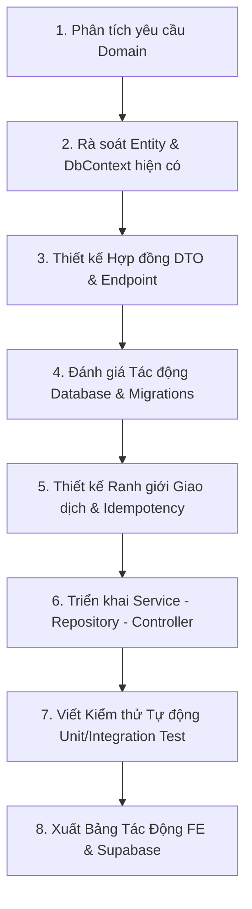

# 📜 QUY TẮC LÀM VIỆC & TIÊU CHUẨN PHÁT TRIỂN THỰC CHIẾN (CareLink_BE)

> **Mục tiêu:** Hướng dẫn AI coding assistant và lập trình viên Backend xây dựng hệ thống vững chắc, an toàn tài chính, tư duy kiến trúc mở để sẵn sàng mở rộng tính năng mới, xử lý triệt để các tình huống thực tế phức tạp, và **luôn chủ động phối hợp đồng bộ với Frontend và Cơ sở dữ liệu Supabase**.

---

## I. TƯ DUY KIẾN TRÚC MỞ & TIẾN HÓA BACKEND (OPEN-ENDED SYSTEM THINKING)

### 1. Danh Mục API Hiện Có là "Hiện Trạng", KHÔNG PHẢI "Giới Hạn Cứng"
- Toàn bộ 86 Endpoints trong Swagger `/openapi/v1.json` là hiện trạng triển khai ở phiên bản hiện tại.
- Khi nhận yêu cầu **phát triển tính năng mới** hoặc **sửa đổi nghiệp vụ cũ** (khi thấy thiết kế hiện tại chưa hợp lý), AI **hoàn toàn có quyền và bắt buộc phải**:
  - Đề xuất tạo Controller, Service hoặc Endpoint mới.
  - Thiết kế DTO mới hoặc mở rộng các trường DTO hiện có.
  - Viết EF Core Migration hoặc câu lệnh SQL bổ sung bảng/cột mới trên Supabase.
- **Tuyệt đối cấm:** Từ chối yêu cầu với lý do *"Backend hiện tại chỉ có 86 API này nên không hỗ trợ"*, hoặc cố tình nhồi nhét một logic mới vào một Service/Controller không đúng trách nhiệm.

### 2. Quy Tắc "Suy Luận 360 Độ" Trước Khi Viết Code Backend
Trước khi cài đặt bất kỳ tính năng nào, AI phải tự trả lời 3 câu hỏi:
1. **Chiều Luồng Nghiệp Vụ & Rủi Ro (Flow & Edge Cases):** Thao tác này bắt đầu từ đâu và kết thúc ở đâu? Nếu khách hàng thoát giữa chừng, mất mạng, hoặc cố tình gửi request trùng lặp thì hệ thống xử lý ra sao?
2. **Chiều Tác Động 3 Vai Trò & Thông Báo (3-Role & Notifications):** Thay đổi ở phía Khách hàng thì Điều dưỡng và Admin bị ảnh hưởng gì? Có cần tạo bản ghi `notifications` bắn chuông cho người dùng không?
3. **Chiều Dữ Liệu & Tài Chính (Financial & Data Atomicity):** Có ảnh hưởng tới số dư ví (`wallets`), lịch sử giao dịch (`wallet_transactions`), phí sàn (60.000đ), hay làm khóa lịch (`Availability`) của điều dưỡng không?

### 3. Quy Trình 8 Bước Phát Triển Tính Năng Mới & Tiến Hóa Backend


---

## II. QUY TẮC BẮT BUỘC PHỐI HỢP CHÉO VỚI FRONTEND & SUPABASE

Khi làm việc trong folder `CareLink_BE`, AI **tuyệt đối không được chỉ chăm chăm nhìn vào code C# của mình**. Bất kỳ thay đổi nào ở Backend đều có thể làm gãy màn hình Frontend hoặc lỗi Database.

### Bắt buộc xuất "Bảng Tác Động & Hướng Dẫn Cập Nhật" cho từng Task:
Mỗi khi thêm một API mới, sửa một DTO, hoặc thay đổi logic nghiệp vụ, AI bên Backend **bắt buộc phải đọc qua mã nguồn `CareLink_FE`** và ghi rõ trong báo cáo:

1. **Phía Frontend (`CareLink_FE`) cần cập nhật:**
   - **Tệp API Client cần sửa:** (Ví dụ: `src/api/caregiverApi.js`, `src/api/familyApi.js`...).
   - **Màn hình / Component bị ảnh hưởng:** (Ví dụ: `CaregiverWallet.jsx`, `CancelBookingModal.jsx`...).
   - **Tên trường DTO thay đổi / bổ sung:** (Ví dụ: `totalPrice` đổi thành `finalAmount`, bổ sung trường `platformFee`...).
2. **Phía Cơ Sở Dữ Liệu (`Supabase / PostgreSQL`) cần cập nhật:**
   - **Câu lệnh Migration / SQL cần chạy:** (Ví dụ: `ALTER TABLE bookings ADD COLUMN IF NOT EXISTS cancellation_reason TEXT;`).
   - **Kế hoạch bảo vệ dữ liệu cũ:** Đảm bảo không làm mất dữ liệu của các bản ghi đã có sẵn trong bảng.

---

## III. PHÂN BIỆT NGUYÊN TẮC BẤT BIẾN VS. CHÍNH SÁCH CÓ THỂ THAY ĐỔI

### 1. Nguyên Tắc Bất Biến (Architectural Invariants - CẤM VI PHẠM)
- **Tính nguyên tử của dữ liệu tài chính (Financial Atomicity):** Khi quyết toán ca trực, tiền vào ví và trạng thái booking phải đồng nhất 100%. Không bao giờ để xảy ra tình trạng "tiền đã cộng nhưng trạng thái booking vẫn lỗi" hoặc ngược lại.
- **Chống xử lý trùng lặp (Idempotency):** Webhook PayOS `POST /api/v1/payments/payos/webhook` hoặc request thanh toán gửi lặp lại tuyệt đối không được phép cộng tiền 2 lần vào ví điều dưỡng.
- **Phân quyền chặt chẽ (Role-based Authorization):** Mọi endpoint nhạy cảm (duyệt hồ sơ, rút tiền, xem doanh thu sàn) bắt buộc phải kiểm tra quyền `[Authorize(Roles = "...")]`.
- **Không để lộ Secrets:** Tuyệt đối không commit chuỗi kết nối Supabase, mật khẩu DB, JWT key, PayOS key lên Git.
- **Chờ lệnh Commit/Push:** Không tự ý commit hoặc push Git khi chưa có sự đồng thuận từ chủ repo.

### 2. Chính Sách Nghiệp Vụ Có Thể Thay Đổi (Evolving Policies - ĐƯỢC PHÉP TIẾN HÓA KHI ĐƯỢC DUYỆT)
- **Mức phí sàn CareLink:** Hiện hành là 60.000 VNĐ/ca (cấu hình trong `PayOsOptions`). Nếu ban dự án quyết định đổi sang thu theo % hoặc phân cấp theo dịch vụ, AI được phép sửa đổi cấu hình và logic tính toán khi có yêu cầu được duyệt.
- **Máy trạng thái Lịch hẹn (Booking State Machine):** Trạng thái hiện hành gồm: `PendingPayment`, `PendingAcceptance`, `Accepted`, `InProgress`, `Completed`, `Canceled`, `Disputed`. Khi hệ thống cần tính năng mới (ví dụ: `RefundPending` hoặc `PartiallyRefunded`), AI được phép đề xuất mở rộng enum và bổ sung quy tắc chuyển trạng thái trong `BookingStateMachine.cs`.
- **Chính sách hủy ca & Thời hạn giữ chỗ:** Thời hạn giữ chỗ thanh toán (hiện hành 30 phút trong luồng Proposal), điều kiện hủy miễn phí có thể điều chỉnh linh hoạt.

---

## IV. XỬ LÝ CÁC TÌNH HUỐNG LẮT LÉO THỰC TẾ (REAL-WORLD EDGE CASES)

### Kịch bản 1: Khách tạo booking nhưng đổi ý không thanh toán (Treo đơn `PendingPayment`)
- Khung giờ của Điều dưỡng chỉ bị tạm giữ trong thời gian giữ chỗ (`PaymentHoldExpiresAt = UtcNow + 15 đến 30 phút`).
- Background Job hoặc logic kiểm tra tự động chuyển trạng thái sang `Canceled` khi hết hạn giữ chỗ mà chưa nhận được thanh toán.
- Sau khi ca bị hủy, khung giờ làm việc của điều dưỡng tự động được giải phóng để khách hàng khác có thể tìm kiếm và đặt lịch.

### Kịch bản 2: Khách trả tiền muộn khi điều dưỡng đã kín lịch (Double Booking Conflict)
- Trong luồng xử lý Webhook / Xác nhận thanh toán, trước khi chuyển trạng thái sang `Accepted`, **bắt buộc kiểm tra trùng lịch (Search-03)**:
  ```csharp
  var hasConflict = await _context.Bookings.AnyAsync(b => 
      b.NurseId == booking.NurseId &&
      b.Id != booking.Id &&
      (b.Status == BookingStatus.Accepted || 
       b.Status == BookingStatus.InProgress || 
       (b.Status == BookingStatus.PendingPayment && b.PaymentHoldExpiresAt > DateTime.UtcNow)) &&
      b.StartTime < booking.EndTime && b.EndTime > booking.StartTime);
  ```
- Nếu có xung đột: **Từ chối chuyển trạng thái, trả về HTTP 409 Conflict**, đồng thời kích hoạt quy trình hoàn tiền tự động hoặc giữ tiền trong ví khách hàng để họ chọn điều dưỡng khác.

### Kịch bản 3: Luồng Đề xuất ca đàm phán trong Chat (`BookingProposal`) chuẩn xác theo Swagger
- **Family (Khách hàng)** tạo đề xuất ca trực gửi cho Caregiver: `POST /api/v1/conversations/{id}/proposals`.
- **Caregiver (Điều dưỡng)** bấm Chấp thuận đề xuất: `PUT /api/v1/conversations/{conversationId}/proposals/{proposalId}/accept`.
- Hệ thống tự động tạo Booking ở trạng thái `PendingPayment` và **giữ chỗ trong 30 phút** để Khách hàng thực hiện thanh toán PayOS. Nếu quá 30 phút không thanh toán, ca tự động hủy và giải phóng lịch!

### Kịch bản 4: Webhook PayOS gửi lặp lại nhiều lần (Chống xử lý trùng Idempotency)
- Webhook nhận tại `POST /api/v1/payments/payos/webhook`.
- Kiểm tra trạng thái thanh toán trước khi cộng tiền:
  ```csharp
  if (payment.Status == PaymentStatus.Paid) {
      return Ok(new { success = true, message = "Giao dịch đã được xử lý trước đó." });
  }
  ```
- Tuyệt đối không cộng tiền lần thứ hai vào ví của điều dưỡng hoặc tạo 2 bản ghi giao dịch trùng lặp.

---

## V. QUẢN LÝ RANH GIỚI GIAO DỊCH DATABASE (TRANSACTIONS)

1. **Một bảng duy nhất (Single Table Write):**
   - Lệnh `await _context.SaveChangesAsync()` đã tự động được EF Core bọc trong một transaction ngầm định của PostgreSQL. Không cần viết thêm code transaction thủ công.
2. **Nhiều bảng phức tạp (Multi-Table / Financial Write):**
   - Khi hoàn tất ca trực: Cập nhật trạng thái Booking -> Tạo bản ghi trừ phí sàn 60.000đ -> Tạo bản ghi cộng thu nhập điều dưỡng -> Cập nhật số dư bảng Wallets.
   - **BẮT BUỘC DÙNG Explicit Transaction:**
     ```csharp
     using var transaction = await _context.Database.BeginTransactionAsync();
     try {
         // ... Các bước cập nhật ...
         await _context.SaveChangesAsync();
         await transaction.CommitAsync();
     } catch {
         await transaction.RollbackAsync();
         throw;
     }
     ```
