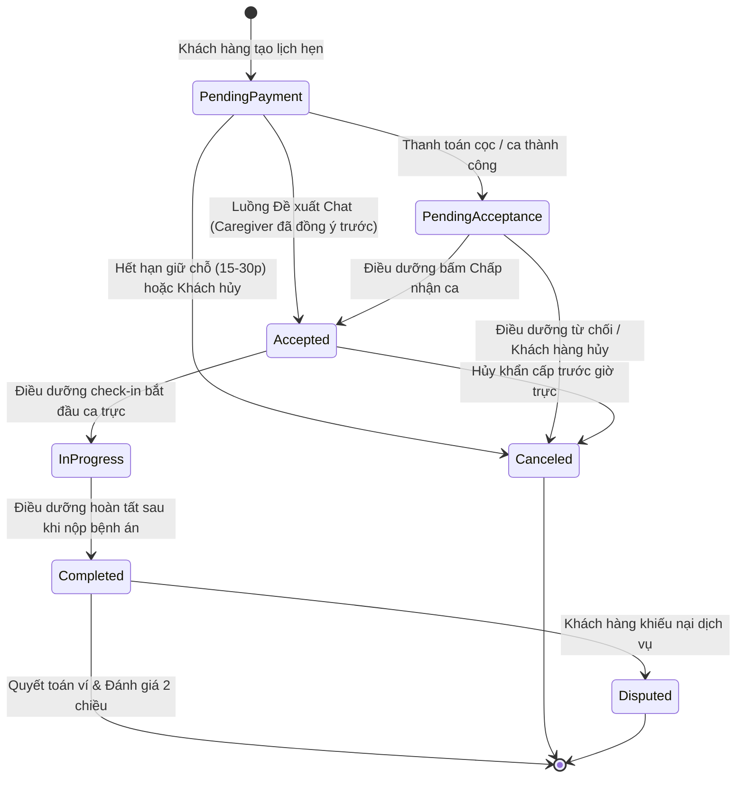

# 📑 HỢP ĐỒNG API & QUY TẮC NGHIỆP VỤ DOMAIN (CareLink_BE)

> **Tài liệu tham chiếu chuẩn cho Backend:** Quy định chi tiết các quy tắc nghiệp vụ lõi (Domain Rules), máy trạng thái (State Machine), cấu trúc dữ liệu và danh mục **100% đầy đủ của 86 Endpoints thuộc 19 nhóm Controller** được trích xuất trực tiếp từ bản Swagger `/openapi/v1.json` của dự án.

---

## I. QUY TẮC NGHIỆP VỤ LÕI (CORE DOMAIN RULES)

### 1. Chính Sách Phí Nền Tảng CareLink (Platform Fee Policy)
- **Chính sách hiện hành:** Phí sàn CareLink là **60.000 VNĐ / ca chăm sóc hoàn thành**.
- **Cơ chế quyết toán thu nhập trong `WalletService.cs`:**
  - Khách hàng thanh toán ca chăm sóc: `TotalPrice`.
  - Phí hoa hồng hệ thống giữ lại: `fee = Math.Min(platformFee, totalPrice)`.
  - Thu nhập thực nhận ghi có vào ví điều dưỡng: `earning = totalPrice - fee`.
  - Tạo 2 giao dịch minh bạch trong `wallet_transactions`:
    - `Type = PlatformFee` (Số tiền `-fee` để hạch toán kế toán).
    - `Type = BookingEarning` (Số tiền `+earning` vào số dư khả dụng).
- **Hiện trạng mã nguồn & Đồng bộ:**
  - Frontend đã cập nhật hiển thị 60.000 VNĐ.
  - Backend đã cấu hình mức 60.000 VNĐ trong `PayOsOptions.cs` (default `60_000m`) và `appsettings.json` (`"PlatformFeePerBooking": 60000`).
  - **Lưu ý kiểm toán:** `BookingQueryService.cs` đang còn dòng hardcode `const decimal platformFeePerBooking = 50000m;` cần được refactor sang đọc từ `PayOsOptions` để nhất quán toàn hệ thống.
  - **Bảo vệ tài chính (Quy tắc bất biến):** Backend phải là nơi xác định và xác thực số tiền thanh toán có thẩm quyền (`booking.TotalPrice`). Cảnh báo kiểm toán: `PaymentService.cs` và `PaymentsController.cs` đang cho phép client truyền `customAmount` ghi đè giá booking, cần xin phê duyệt để loại bỏ lỗ hổng này.

---

### 2. Máy Trạng Thái Lịch Hẹn Thực Tế (`BookingStateMachine.cs`)
Trạng thái Lịch hẹn trong mã nguồn `CareLinkAPI.Common.Enums.BookingStatus` được quy định chặt chẽ như sau:

- **Quy tắc chuyển đổi trạng thái đặc thù:**
  - **Luồng thông thường:** `PendingPayment` -> Khách trả tiền -> `PendingAcceptance` -> Điều dưỡng bấm Nhận ca -> `Accepted` -> `InProgress` -> `Completed`.
  - **Luồng đàm phán trong Chat (`BookingProposal`):** 
    1. Family tạo đề xuất: `POST /api/v1/conversations/{id}/proposals`.
    2. Caregiver chấp thuận: `PUT /api/v1/conversations/{conversationId}/proposals/{proposalId}/accept`.
    3. Hệ thống tự động tạo Booking ở trạng thái `PendingPayment` và **giữ chỗ trong 30 phút**.
    4. Khi Family thanh toán PayOS thành công, ca trực được phép chuyển thẳng từ `PendingPayment` -> `Accepted` (hàm `EnsureCanTransitionProposal`).
  - **Hủy ca (`Canceled`):** Bắt buộc người hủy phải gửi lý do (`CancellationReason`).

---

## II. DANH MỤC ĐẦY ĐỦ 100% CỦA 86 ENDPOINTS TRONG 19 NHÓM TỪ SWAGGER `/openapi/v1.json`

### 1. Nhóm Addresses (5 Endpoints)
| HTTP Method | Route | Tóm tắt chức năng | Request DTO / Params | Response DTO | Authorization |
| :--- | :--- | :--- | :--- | :--- | :---: |
| `GET` | `/api/v1/addresses` | Lấy danh sách địa chỉ nhận chăm sóc của khách hàng hiện tại | None | `List<AddressResponse>` | Customer |
| `POST` | `/api/v1/addresses` | Thêm địa chỉ nhận chăm sóc mới | `CreateAddressRequest` | `AddressResponse` | Customer |
| `GET` | `/api/v1/addresses/{id}` | Lấy chi tiết một địa chỉ theo ID | Route `{id}` | `AddressResponse` | Customer |
| `PUT` | `/api/v1/addresses/{id}` | Cập nhật địa chỉ nhận chăm sóc | Route `{id}`, `UpdateAddressRequest` | `AddressResponse` | Customer |
| `DELETE` | `/api/v1/addresses/{id}` | Xóa một địa chỉ nhận chăm sóc | Route `{id}` | `OperationResultResponse` | Customer |

---

### 2. Nhóm Auth (7 Endpoints)
| HTTP Method | Route | Tóm tắt chức năng | Request DTO / Params | Response DTO | Authorization |
| :--- | :--- | :--- | :--- | :--- | :---: |
| `POST` | `/api/v1/auth/register` | Đăng ký tài khoản mới (Customer hoặc Nurse) | `RegisterRequest` | `AuthResponse` | AllowAnonymous |
| `POST` | `/api/v1/auth/login` | Đăng nhập bằng Email & Password | `LoginRequest` | `AuthResponse` | AllowAnonymous |
| `POST` | `/api/v1/auth/google-login` | Đăng nhập bằng Google OAuth idToken | `GoogleLoginRequest` | `AuthResponse` | AllowAnonymous |
| `POST` | `/api/v1/auth/refresh-token` | Làm mới Access Token bằng Refresh Token | `RefreshTokenRequest` | `AuthResponse` | AllowAnonymous |
| `POST` | `/api/v1/auth/logout` | Đăng xuất – Thu hồi Refresh Token | None | `OperationResultResponse` | Authorize |
| `POST` | `/api/v1/auth/forgot-password` | Yêu cầu gửi mã OTP đặt lại mật khẩu qua email | `ForgotPasswordRequest` | `OperationResultResponse` | AllowAnonymous |
| `POST` | `/api/v1/auth/reset-password` | Đặt lại mật khẩu mới bằng mã OTP | `ResetPasswordRequest` | `OperationResultResponse` | AllowAnonymous |
| `POST` | `/api/v1/auth/change-password` | Đổi mật khẩu tài khoản đang đăng nhập | `ChangePasswordRequest` | `OperationResultResponse` | Authorize |

---

### 3. Nhóm Bookings (8 Endpoints)
| HTTP Method | Route | Tóm tắt chức năng | Request DTO / Params | Response DTO | Authorization |
| :--- | :--- | :--- | :--- | :--- | :---: |
| `POST` | `/api/v1/bookings` | Tạo ca chăm sóc (status `PendingPayment`) | `CreateBookingRequest` | `BookingResponse` | Customer |
| `GET` | `/api/v1/bookings` | Danh sách ca chăm sóc (Customer: của mình, Nurse: được phân, Admin: tất cả) | Query phân trang, status | `PagedResultOfBookingResponse` | Authorize |
| `GET` | `/api/v1/bookings/{id}` | Xem chi tiết ca chăm sóc theo ID | Route `{id}` | `BookingResponse` | Authorize |
| `PUT` | `/api/v1/bookings/{id}/accept` | Điều dưỡng chấp nhận ca (`PendingAcceptance` -> `Accepted`) | Route `{id}` | `BookingResponse` | Nurse |
| `PUT` | `/api/v1/bookings/{id}/reject` | Điều dưỡng từ chối ca; giải phóng slot và thông báo khách | Route `{id}`, `RejectBookingRequest` | `BookingResponse` | Nurse |
| `PUT` | `/api/v1/bookings/{id}/start` | Điều dưỡng check-in bắt đầu ca (`Accepted` -> `InProgress`) | Route `{id}` | `BookingResponse` | Nurse |
| `PUT` | `/api/v1/bookings/{id}/finish` | Điều dưỡng hoàn tất ca sau khi nộp bệnh án (`InProgress` -> `Completed`) | Route `{id}` | `BookingResponse` | Nurse |
| `PUT` | `/api/v1/bookings/{id}/cancel` | Khách hoặc điều dưỡng hủy ca; hoàn tiền theo chính sách | Route `{id}`, `CancelBookingRequest` | `BookingResponse` | Authorize |

---

### 4. Nhóm Conversations (9 Endpoints)
| HTTP Method | Route | Tóm tắt chức năng | Request DTO / Params | Response DTO | Authorization |
| :--- | :--- | :--- | :--- | :--- | :---: |
| `GET` | `/api/v1/conversations` | Lấy danh sách hội thoại của người dùng hiện tại | Query phân trang | `PagedResultOfConversationListItemResponse` | Authorize |
| `POST` | `/api/v1/conversations` | Lấy hoặc tạo hội thoại giữa Family và Caregiver | `StartConversationRequest` | `ConversationResponse` | Authorize |
| `GET` | `/api/v1/conversations/{id}` | Lấy chi tiết một hội thoại theo ID và kiểm tra quyền | Route `{id}` | `ConversationResponse` | Authorize |
| `GET` | `/api/v1/conversations/{id}/messages` | Lấy danh sách tin nhắn theo phân trang | Route `{id}`, Query | `PagedResultOfMessageResponse` | Authorize |
| `POST` | `/api/v1/conversations/{id}/messages` | Gửi tin nhắn văn bản vào hội thoại | Route `{id}`, `SendMessageRequest` | `MessageResponse` | Authorize |
| `GET` | `/api/v1/conversations/{id}/proposals` | Lấy danh sách các đề xuất ca chăm sóc trong hội thoại | Route `{id}` | `List<BookingProposalResponse>` | Authorize |
| `POST` | `/api/v1/conversations/{id}/proposals` | Family tạo đề xuất ca chăm sóc mới gửi cho Caregiver | Route `{id}`, `CreateProposalRequest` | `BookingProposalResponse` | Customer |
| `PUT` | `/api/v1/conversations/{cId}/proposals/{pId}/accept` | Caregiver chấp thuận đề xuất. Tự tạo Booking `PendingPayment` 30 phút | Route params, `AcceptProposalRequest` | `ProposalActionResultResponse` | Nurse |
| `PUT` | `/api/v1/conversations/{cId}/proposals/{pId}/reject` | Caregiver từ chối đề xuất ca chăm sóc | Route params, `RejectProposalRequest` | `ProposalActionResultResponse` | Nurse |

---

### 5. Nhóm Handbook (9 Endpoints)
| HTTP Method | Route | Tóm tắt chức năng | Request DTO / Params | Response DTO | Authorization |
| :--- | :--- | :--- | :--- | :--- | :---: |
| `GET` | `/api/v1/handbook` | [Public] Lấy danh sách bài viết cẩm nang đã xuất bản | Query category, search, page | `PagedResultOfHandbookArticleListItemDto` | AllowAnonymous |
| `GET` | `/api/v1/handbook/{idOrSlug}` | [Public] Xem chi tiết bài viết cẩm nang theo GUID hoặc Slug | Route `{idOrSlug}` | `HandbookArticleDetailDto` | AllowAnonymous |
| `GET` | `/api/v1/handbook/admin` | [Admin] Lấy toàn bộ danh sách bài viết quản trị | Query status, page | `PagedResultOfHandbookAdminListItemDto` | Admin |
| `POST` | `/api/v1/handbook/admin` | [Admin] Tạo bài viết cẩm nang y tế mới | `CreateHandbookArticleDto` | `HandbookArticleDetailDto` | Admin |
| `GET` | `/api/v1/handbook/admin/{id}` | [Admin] Xem chi tiết bài viết cẩm nang để chỉnh sửa | Route `{id}` | `HandbookArticleDetailDto` | Admin |
| `PUT` | `/api/v1/handbook/admin/{id}` | [Admin] Cập nhật toàn bộ thông tin bài viết cẩm nang | Route `{id}`, `UpdateHandbookArticleDto` | `HandbookArticleDetailDto` | Admin |
| `DELETE`| `/api/v1/handbook/admin/{id}` | [Admin] Xóa bài viết cẩm nang (soft-delete hoặc hardDelete) | Route `{id}`, Query `hardDelete` | `OperationResultResponse` | Admin |
| `PATCH` | `/api/v1/handbook/admin/{id}/status` | [Admin] Đổi trạng thái bài viết (published, draft, archived) | Route `{id}`, `UpdateHandbookStatusDto` | `HandbookArticleDetailDto` | Admin |
| `PATCH` | `/api/v1/handbook/admin/{id}/featured` | [Admin] Bật / Tắt trạng thái bài viết Nổi bật | Route `{id}`, `UpdateHandbookFeaturedDto` | `HandbookArticleDetailDto` | Admin |

---

### 6. Nhóm Notifications (4 Endpoints)
| HTTP Method | Route | Tóm tắt chức năng | Request DTO / Params | Response DTO | Authorization |
| :--- | :--- | :--- | :--- | :--- | :---: |
| `GET` | `/api/v1/notifications` | Lấy danh sách thông báo phân trang, lọc đã đọc/chưa đọc | Query phân trang | `PagedResultOfNotificationResponse` | Authorize |
| `GET` | `/api/v1/notifications/unread-count` | Lấy số lượng thông báo chưa đọc (hiển thị chuông) | None | `UnreadCountResponse` | Authorize |
| `PUT` | `/api/v1/notifications/{id}/read` | Đánh dấu một thông báo cụ thể là đã đọc | Route `{id}` | `OperationResultResponse` | Authorize |
| `PUT` | `/api/v1/notifications/read-all` | Đánh dấu tất cả thông báo chưa đọc là đã đọc | None | `MarkAllReadResponse` | Authorize |

---

### 7. Nhóm NurseProfile (10 Endpoints)
| HTTP Method | Route | Tóm tắt chức năng | Request DTO / Params | Response DTO | Authorization |
| :--- | :--- | :--- | :--- | :--- | :---: |
| `GET` | `/api/v1/nurse/profile` | Lấy thông tin hồ sơ năng lực và khu vực hoạt động của Nurse | None | `NurseProfileResponse` | Nurse |
| `PUT` | `/api/v1/nurse/profile` | Cập nhật hồ sơ năng lực và bán kính hoạt động ưu tiên | `UpdateNurseProfileRequest` | `NurseProfileResponse` | Nurse |
| `GET` | `/api/v1/nurse/availability` | Lấy danh sách lịch rảnh định kỳ của Nurse | None | `List<NurseAvailabilityResponse>` | Nurse |
| `POST` | `/api/v1/nurse/availability` | Thêm một khung giờ rảnh mới | `CreateNurseAvailabilityRequest` | `NurseAvailabilityResponse` | Nurse |
| `PUT` | `/api/v1/nurse/availability` | Thiết lập / đồng bộ toàn bộ lịch rảnh định kỳ | `SetNurseAvailabilityRequest` | `List<NurseAvailabilityResponse>` | Nurse |
| `DELETE`| `/api/v1/nurse/availability/{id}` | Xóa một khung giờ rảnh theo ID | Route `{id}` | `OperationResultResponse` | Nurse |
| `POST` | `/api/v1/nurse/documents` | Nộp hồ sơ chứng thực gồm CCCD 2 mặt, Ảnh selfie, Bằng cấp/Thẻ SV, CCHN | `UploadNurseDocumentRequest` | `NurseDocumentResponse` | Nurse |
| `GET` | `/api/v1/nurse/documents` | Lấy danh sách các chứng từ và trạng thái kiểm duyệt | None | `List<NurseDocumentResponse>` | Nurse |
| `POST` | `/api/v1/nurse/documents/re-submit` | Nộp lại hồ sơ sau khi bị Admin từ chối | `ReSubmitNurseVerificationRequest` | `OperationResultResponse` | Nurse |
| `GET` | `/api/v1/nurse/verification-status` | Tra cứu trạng thái xét duyệt, giấy tờ còn thiếu và ghi chú phản hồi | None | `NurseVerificationStatusResponse` | Nurse |

---

### 8. Nhóm Nurses (1 Endpoint)
| HTTP Method | Route | Tóm tắt chức năng | Request DTO / Params | Response DTO | Authorization |
| :--- | :--- | :--- | :--- | :--- | :---: |
| `GET` | `/api/v1/nurses/search` | Tìm kiếm điều dưỡng theo quận, đánh giá sao, chuyên môn, xếp theo khoảng cách Haversine | Query params | `PagedResultOfNurseSearchItemResponse` | AllowAnonymous |

---

### 9. Nhóm Payments (4 Endpoints)
| HTTP Method | Route | Tóm tắt chức năng | Request DTO / Params | Response DTO | Authorization |
| :--- | :--- | :--- | :--- | :--- | :---: |
| `POST` | `/api/v1/bookings/{bookingId}/payments` | Khách hàng tạo link thanh toán PayOS cho ca đang chờ thanh toán | Route `{bookingId}` | `CreatePaymentLinkResponse` | Customer |
| `GET` | `/api/v1/bookings/{bookingId}/payments` | Xem thông tin thanh toán của booking | Route `{bookingId}` | `PaymentResponse` | Authorize |
| `POST` | `/api/v1/payments/payos/webhook` | Webhook PayOS gọi về khi có giao dịch (xác thực chữ ký, chống trùng lặp) | PayOS Webhook Body | `OperationResultResponse` | AllowAnonymous |
| `POST` | `/api/v1/admin/bookings/{bookingId}/refund` | Admin hoàn tiền cho booking đã thanh toán (toàn phần hoặc một phần) | Route `{bookingId}`, `RefundPaymentRequest` | `PaymentResponse` | Admin |

---

### 10. Nhóm Recipients (5 Endpoints)
| HTTP Method | Route | Tóm tắt chức năng | Request DTO / Params | Response DTO | Authorization |
| :--- | :--- | :--- | :--- | :--- | :---: |
| `GET` | `/api/v1/recipients` | Lấy danh sách người được chăm sóc của khách hàng hiện tại | None | `List<CareRecipientResponse>` | Customer |
| `POST` | `/api/v1/recipients` | Thêm mới một người được chăm sóc (tiền sử bệnh, ghi chú) | `CreateCareRecipientRequest` | `CareRecipientResponse` | Customer |
| `GET` | `/api/v1/recipients/{id}` | Lấy thông tin chi tiết một người được chăm sóc theo ID | Route `{id}` | `CareRecipientResponse` | Customer |
| `PUT` | `/api/v1/recipients/{id}` | Cập nhật thông tin người được chăm sóc | Route `{id}`, `UpdateCareRecipientRequest` | `CareRecipientResponse` | Customer |
| `DELETE`| `/api/v1/recipients/{id}` | Xóa hồ sơ người được chăm sóc | Route `{id}` | `OperationResultResponse` | Customer |

---

### 11. Nhóm Users (2 Endpoints)
| HTTP Method | Route | Tóm tắt chức năng | Request DTO / Params | Response DTO | Authorization |
| :--- | :--- | :--- | :--- | :--- | :---: |
| `GET` | `/api/v1/users/me` | Lấy thông tin cá nhân và hồ sơ người dùng hiện tại (Customer hoặc Nurse) | None | `UserProfileResponse` | Authorize |
| `PUT` | `/api/v1/users/me` | Cập nhật thông tin cá nhân của người dùng hiện tại | `UpdateUserProfileRequest` | `UserProfileResponse` | Authorize |

---

### 12. Nhóm Wallet (4 Endpoints)
| HTTP Method | Route | Tóm tắt chức năng | Request DTO / Params | Response DTO | Authorization |
| :--- | :--- | :--- | :--- | :--- | :---: |
| `GET` | `/api/v1/wallet/me` | Điều dưỡng xem số dư ví khả dụng và tổng thu nhập | None | `WalletResponse` | Nurse |
| `GET` | `/api/v1/wallet/me/transactions` | Điều dưỡng xem lịch sử giao dịch ví (thu nhập ca, trừ phí sàn 60.000đ) | Query phân trang | `PagedResultOfWalletTransactionResponse` | Nurse |
| `POST` | `/api/v1/wallet/payouts` | Điều dưỡng tạo yêu cầu rút tiền về tài khoản ngân hàng | `CreatePayoutRequest` | `PayoutResponse` | Nurse |
| `GET` | `/api/v1/wallet/payouts` | Điều dưỡng xem các yêu cầu rút tiền của mình | None | `List<PayoutResponse>` | Nurse |

---

### 13. Nhóm AdminDashboard (2 Endpoints)
| HTTP Method | Route | Tóm tắt chức năng | Request DTO / Params | Response DTO | Authorization |
| :--- | :--- | :--- | :--- | :--- | :---: |
| `GET` | `/api/v1/admin/dashboard/summary` | Thống kê tổng quan Admin Dashboard (GMV, Phí nền tảng, Số lượng ca, Khiếu nại) | None | `DashboardSummaryDto` | Admin |
| `GET` | `/api/v1/admin/dashboard/revenue` | Thống kê doanh thu nền tảng và GMV theo thời gian | Query range, month | `RevenueMetricDto` | Admin |

---

### 14. Nhóm Disputes (4 Endpoints)
| HTTP Method | Route | Tóm tắt chức năng | Request DTO / Params | Response DTO | Authorization |
| :--- | :--- | :--- | :--- | :--- | :---: |
| `POST` | `/api/v1/bookings/{bookingId}/disputes` | Khách hàng tạo khiếu nại cho ca chăm sóc | Route `{bookingId}`, `CreateDisputeDto` | `DisputeResponseDto` | Customer |
| `GET` | `/api/v1/admin/disputes` | Lấy danh sách tất cả khiếu nại phân trang và lọc theo trạng thái | Query phân trang, status | `PagedResultOfDisputeResponseDto` | Admin |
| `PUT` | `/api/v1/admin/disputes/{id}` | Quản trị viên xử lý khiếu nại (Hoàn tiền hoặc Bác bỏ) | Route `{id}`, `ResolveDisputeDto` | `DisputeResponseDto` | Admin |
| `GET` | `/api/v1/disputes/{id}` | Xem chi tiết khiếu nại theo ID | Route `{id}` | `DisputeResponseDto` | Authorize |

---

### 15. Nhóm HealthRecords (4 Endpoints)
| HTTP Method | Route | Tóm tắt chức năng | Request DTO / Params | Response DTO | Authorization |
| :--- | :--- | :--- | :--- | :--- | :---: |
| `POST` | `/api/v1/bookings/{bookingId}/health-record` | Ghi nhận bệnh án lâm sàng cho ca chăm sóc | Route `{bookingId}`, `SubmitHealthRecordDto` | `HealthRecordResponseDto` | Nurse |
| `PUT` | `/api/v1/bookings/{bookingId}/health-record` | Cập nhật bệnh án khi ca đang `InProgress` | Route `{bookingId}`, `UpdateHealthRecordDto` | `HealthRecordResponseDto` | Nurse |
| `GET` | `/api/v1/bookings/{bookingId}/health-record` | Xem chi tiết bệnh án theo Booking ID | Route `{bookingId}` | `HealthRecordResponseDto` | Authorize |
| `GET` | `/api/v1/recipients/{recipientId}/health-history` | Xem lịch sử theo dõi sức khỏe của người nhận chăm sóc | Route `{recipientId}` | `List<HealthHistoryItemDto>` | Authorize |

---

### 16. Nhóm NurseVerifications (4 Endpoints)
| HTTP Method | Route | Tóm tắt chức năng | Request DTO / Params | Response DTO | Authorization |
| :--- | :--- | :--- | :--- | :--- | :---: |
| `GET` | `/api/v1/admin/nurse-verifications` | Lấy danh sách hồ sơ Điều dưỡng cần duyệt | Query status, search, page | `PagedResultOfAdminNurseVerificationItemResponse` | Admin |
| `GET` | `/api/v1/admin/nurse-verifications/expiring-licenses` | Lấy danh sách các Điều dưỡng có chứng chỉ hành nghề sắp hết hạn | Query days (mặc định 30) | `List<ExpiringLicenseNurseResponse>` | Admin |
| `GET` | `/api/v1/admin/nurse-verifications/{id}` | Xem chi tiết hồ sơ năng lực của một Điều dưỡng kèm tất cả chứng từ | Route `{id}` | `AdminNurseVerificationDetailResponse` | Admin |
| `PUT` | `/api/v1/admin/nurse-verifications/{id}` | Admin phê duyệt (`Approve`) hoặc Từ chối (`Reject` kèm lý do) hồ sơ | Route `{id}`, `AdminReviewNurseVerificationRequest` | `OperationResultResponse` | Admin |

---

### 17. Nhóm Payouts (3 Endpoints)
| HTTP Method | Route | Tóm tắt chức năng | Request DTO / Params | Response DTO | Authorization |
| :--- | :--- | :--- | :--- | :--- | :---: |
| `GET` | `/api/v1/admin/payouts` | Danh sách yêu cầu rút tiền của điều dưỡng (lọc status) | Query phân trang, status | `PagedResultOfPayoutResponse` | Admin |
| `PUT` | `/api/v1/admin/payouts/{id}/approve` | Duyệt yêu cầu rút tiền sau khi chuyển khoản (ghi mã tham chiếu ngân hàng) | Route `{id}`, `ApprovePayoutRequest` | `PayoutResponse` | Admin |
| `PUT` | `/api/v1/admin/payouts/{id}/reject` | Từ chối yêu cầu rút tiền kèm lý do | Route `{id}`, `RejectPayoutRequest` | `PayoutResponse` | Admin |

---

### 18. Nhóm Reviews (5 Endpoints)
| HTTP Method | Route | Tóm tắt chức năng | Request DTO / Params | Response DTO | Authorization |
| :--- | :--- | :--- | :--- | :--- | :---: |
| `POST` | `/api/v1/bookings/{bookingId}/reviews` | Gửi đánh giá ca chăm sóc 2 chiều (Khách hàng và Điều dưỡng) | Route `{bookingId}`, `CreateReviewDto` | `ReviewResponseDto` | Authorize |
| `GET` | `/api/v1/reviews/{id}` | Xem chi tiết đánh giá theo ID | Route `{id}` | `ReviewResponseDto` | Authorize |
| `GET` | `/api/v1/reviews/users/{userId}` | Lấy danh sách đánh giá nhận được của một người dùng | Route `{userId}`, Query phân trang | `PagedResultOfReviewResponseDto` | Authorize |
| `GET` | `/api/v1/nurses/{nurseId}/reviews` | Lấy danh sách đánh giá của Điều dưỡng | Route `{nurseId}`, Query phân trang | `PagedResultOfReviewResponseDto` | AllowAnonymous |
| `GET` | `/api/v1/nurses/{nurseId}/reviews/summary` | Xem tổng hợp điểm đánh giá trung bình và số lượng đánh giá của Điều dưỡng | Route `{nurseId}` | `NurseRatingSummaryDto` | AllowAnonymous |

---

### 19. Nhóm Services (7 Endpoints)
| HTTP Method | Route | Tóm tắt chức năng | Request DTO / Params | Response DTO | Authorization |
| :--- | :--- | :--- | :--- | :--- | :---: |
| `GET` | `/api/v1/services` | Lấy danh sách tất cả dịch vụ đang hoạt động | None | `List<ServiceResponseDto>` | AllowAnonymous |
| `POST` | `/api/v1/services` | Tạo mới dịch vụ chăm sóc | `CreateServiceDto` | `ServiceResponseDto` | Admin |
| `GET` | `/api/v1/services/admin` | Lấy danh sách dịch vụ phân trang, tìm kiếm và lọc trạng thái | Query phân trang, status | `PagedResultOfServiceResponseDto` | Admin |
| `GET` | `/api/v1/services/{id}` | Xem chi tiết dịch vụ theo ID | Route `{id}` | `ServiceResponseDto` | AllowAnonymous |
| `PUT` | `/api/v1/services/{id}` | Cập nhật thông tin dịch vụ | Route `{id}`, `UpdateServiceDto` | `ServiceResponseDto` | Admin |
| `DELETE`| `/api/v1/services/{id}` | Vô hiệu hóa dịch vụ (Soft Delete / Deactivate) | Route `{id}` | `OperationResultResponse` | Admin |
| `PATCH` | `/api/v1/services/{id}/status` | Kích hoạt hoặc vô hiệu hóa dịch vụ | Route `{id}`, `UpdateServiceStatusDto` | `ServiceResponseDto` | Admin |

---

### 20. Hợp đồng Nâng cấp Master V3 (Cinema Slots & Mentor Feedback)
| HTTP Method | Route | Tóm tắt chức năng | Request DTO / Params | Response DTO | Authorization |
| :--- | :--- | :--- | :--- | :--- | :---: |
| `GET` | `/api/v1/nurses/{nurseId}/available-slots` | Lấy danh sách 16 slot rạp phim (06:00 - 22:00), áp dụng đệm di chuyển 60 phút giữa 2 khách khác nhau | Query `date` (YYYY-MM-DD), `customerId` | `NurseDaySlotsResponse` | AllowAnonymous / Authorize |
| `GET` | `/api/v1/nurses/{nurseId}/distance` | Tính khoảng cách địa lý Haversine độc lập giữa điều dưỡng và khách hàng | Query `addressId`, `latitude`, `longitude` | `NurseDistanceResponse` | AllowAnonymous / Authorize |
| `PUT` | `/api/v1/conversations/{conversationId}/proposals/{proposalId}/counter` | Điều dưỡng đề xuất mức giá mới (Counter-Offer) | `CounterProposalRequest` (`counterPrice`, `counterNote`) | `ProposalActionResultResponse` | Nurse |
| `PUT` | `/api/v1/conversations/{conversationId}/proposals/{proposalId}/accept-counter` | Gia đình chấp nhận giá đề xuất mới và tạo Booking `PendingPayment` | None | `ProposalActionResultResponse` | Customer |
| `POST` | `/api/v1/bookings` | Đặt ca trọn gói một lần (One-shot Booking): Combo dịch vụ, giờ phát sinh, cờ bảo mật bệnh án, trả ngay VietQR PayOS | `CreateBookingRequest` | `BookingResponse` (kèm `paymentInfo`) | Customer |
| `PUT` | `/api/v1/bookings/{id}/reject` | Điều dưỡng báo bận đột xuất: Hủy ca, hoàn tiền 100% Escrow, trả về gợi ý điều dưỡng thay thế | `RejectBookingRequest` | `BookingResponse` (kèm `suggestedNurses`) | Nurse |
| `PUT` | `/api/v1/bookings/{id}/finish` | Điều dưỡng kết ca dựa trên đầu việc lâm sàng hoàn tất và nộp bệnh án (ghi nhận `actual_finished_at`) | None | `BookingResponse` | Nurse |

*(Kèm 1 Root Endpoint chẩn đoán: `GET /` -> Health Check Server).*

